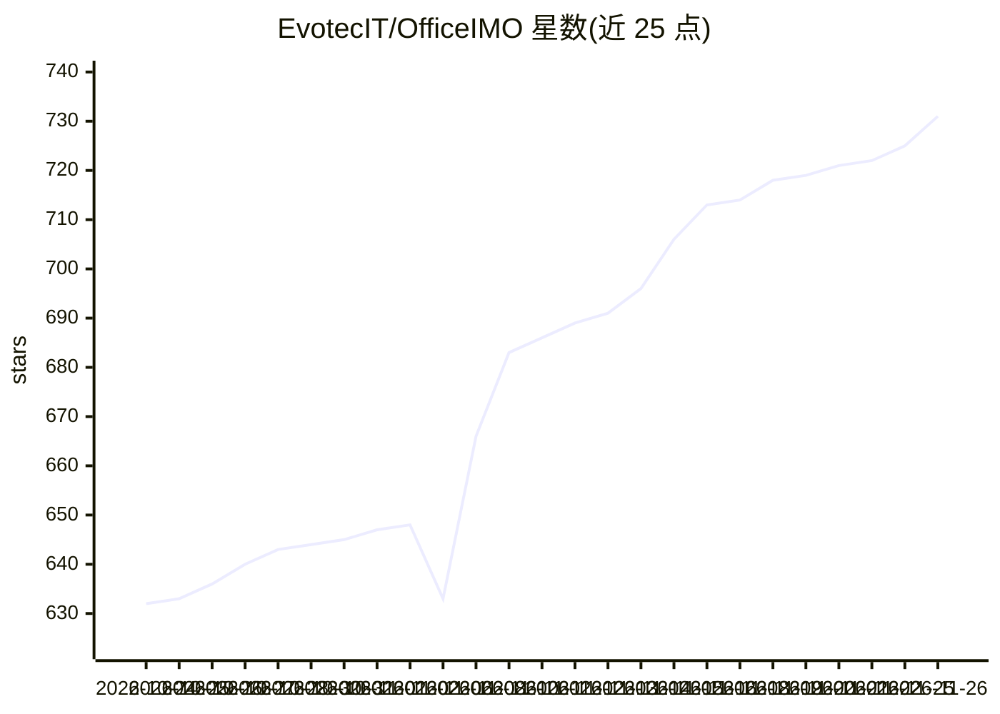

# EvotecIT/OfficeIMO

⭐ 731 · C# · MIT · 推送 2026-11-25 · [GitHub](https://github.com/EvotecIT/OfficeIMO) · [官网](https://officeimo.com/) · 组织维护

**.NET 无 COM 的 Office/PDF 等文档创建、转换与读取库**

面向 .NET 开发者的文档处理库集合：无需安装 Microsoft Office 或 COM 组件，即可创建、读取、编辑、转换 Word、Excel、PowerPoint、PDF、Markdown 等 20 多种格式。所有格式遵循统一 API 形状（Create/Load/Save/Add*），转换结果用 ConversionReport 报告丢失内容；按格式拆分为独立 NuGet 包，并提供主题系统、批量转换断点续跑、OCR、证书签名、打印等功能。附带 PowerShell 模块 PSWriteOffice、CLI 工具 OfficeIMO.Tool（经 MCP 向 AI agent 提供转换/提取/搜索）、桌面应用 OfficeIMO Studio。

## 筛选速览

| 维度 | 判定 | 备注 |
|---|---|---|
| AI 角色 | `ai-enhanced` | 去掉 AI 部分产品仍成立 |
| 许可风险 | `permissive` | MIT |
| 部署形态 | `None` |  |
| 模型依赖 | — | README 未给出锁定关系 |
| 硬件要求 | — | 无带数字的原话,不猜 |
| 安装摩擦 | `medium` | 含编译或系统依赖之一 |
| 成熟度 | — | 结构信号不足 |

## 能力要点

- 无 COM、不依赖 Microsoft Office 的文档创建/读取/编辑/转换
- 统一 API 形状覆盖 20+ 格式，支持格式间互转并报告转换丢失
- OfficeIMO.Tool 通过 MCP 向 AI agent 提供转换、提取与搜索能力
- OfficeDocumentReader 支持任意格式的读取、搜索与分块，用于索引和 AI 摄取

## 适用场景

- 在服务端/容器/构建代理中批量生成和转换 Office 与 PDF 文档
- 为 RAG 索引流水线读取、搜索和分块各类文档
- 为 AI agent 提供 MCP 文档工具
- 扫描件 OCR 与文档证书签名

## 场景标签

`OCR` `文档解析` · 领域:知识与检索

## 证据(README 行号)

> L7: OfficeIMO creates, edits, reads and converts Word, Excel, PowerPoint, PDF, Markdown and two dozen other document for
> L39: |Read for search or AI|`OfficeDocumentReader` from `OfficeIMO.Reader.All`|
> L116: - OfficeIMO.Tool: the `officeimo` command line, from `dotnet tool install --global OfficeIMO.Tool`. It also serves

## 星数曲线

2026-10-24 632 → 2026-11-26 731（+99）

---
*卡片 v1 · prompt 1.4 · 生成 2026-11-24 · 置信度 high · 依据 README sha `c52793b74f5e` · [字段定义](../../DATASET.md)*
