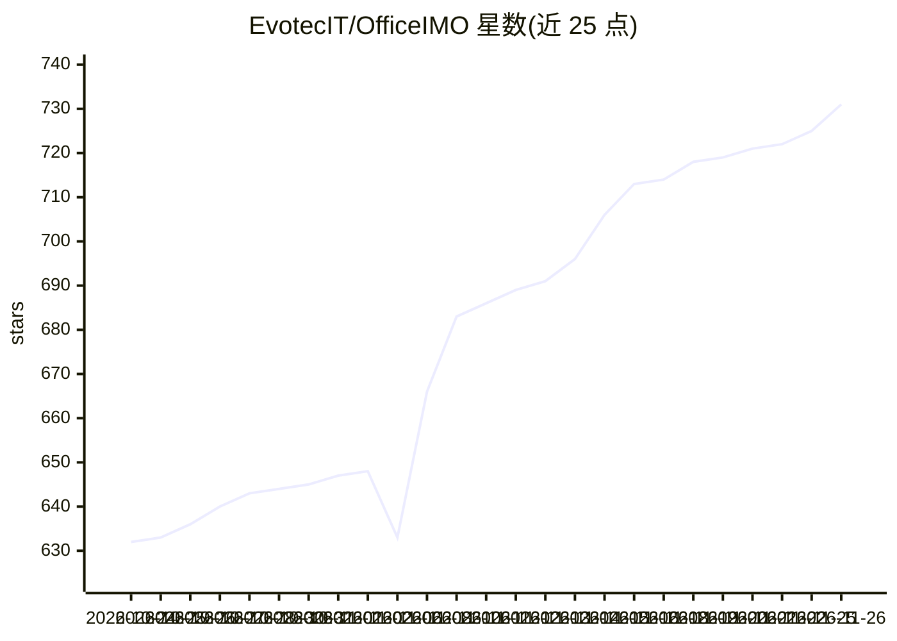

# EvotecIT/OfficeIMO

⭐ 731 · C# · MIT · 推送 2026-11-25 · [GitHub](https://github.com/EvotecIT/OfficeIMO) · [官网](https://officeimo.com/) · 组织维护

**免 COM 的 .NET 库：创建/读取/转换 Office、PDF 等文档**

面向 .NET 开发者的文档处理库集合，无需安装 Microsoft Office 或 COM，可在代码中创建、编辑、读取、转换 Word、Excel、PowerPoint、PDF、Markdown 等二十余种格式。机制上按格式拆分为独立 NuGet 包（OfficeIMO.Word/Excel/Pdf 等），共享 OfficeTheme 主题让新文档自带样式；OfficeConverter 支持文件与文件夹批量转换并提供损失报告（HasLoss/ThrowIfLoss）与断点续转；OfficeIMO.Reader.All 支持为索引和 AI 读取与分块；附带 PowerShell 模块、CLI 工具（经 MCP 向 AI agent 提供转换/提取/搜索）、桌面应用 OfficeIMO Studio。跨 Windows/macOS/Linux，目标 netstandard2.0/net8.0/net10。

## 筛选速览

| 维度 | 判定 | 备注 |
|---|---|---|
| AI 角色 | `ai-enhanced` | 去掉 AI 部分产品仍成立 |
| 许可风险 | `permissive` | MIT |
| 部署形态 | `None` |  |
| 模型依赖 | — | README 未给出锁定关系 |
| 硬件要求 | — | 无带数字的原话,不猜 |
| 安装摩擦 | `medium` | 含编译或系统依赖之一 |
| 成熟度 | — | 结构信号不足 |

## 能力要点

- 覆盖 Word/Excel/PPT/PDF/Markdown 等二十余种格式的创建、读取与互转
- 按格式拆分的 NuGet 包与转换适配器（OfficeIMO.{Source}.{Target}）
- OfficeConverter 批量转换支持损失报告与断点续转（ResumeFrom）
- officeimo CLI 经 MCP 向 Claude Code、Codex、VS Code、Cursor 等 AI agent 提供文档工具

## 适用场景

- 在 .NET 服务端批量生成带主题样式的 Word 报告/Excel 图表/PPT
- 把 docx、xlsx 等文档批量转换为 PDF 或 HTML
- 为检索或 AI 摄取读取并分块任意支持的文档格式
- 在 Linux 容器中处理 Office 文档而不安装 Microsoft Office

## 场景标签

`文档解析` · 领域:知识与检索

## 证据(README 行号)

> L7: OfficeIMO creates, edits, reads and converts Word, Excel, PowerPoint, PDF, Markdown and two dozen other document for
> L102: |Read, search and chunk any format for indexing and AI ingestion|OfficeIMO.Reader.All, or one `OfficeIMO.Reader.{F
> L117: - OfficeIMO.Tool: the `officeimo` command line, from `dotnet tool install --global OfficeIMO.Tool`. It also serves

## 星数曲线

2026-10-24 632 → 2026-11-26 731（+99）

---
*卡片 v1 · prompt 1.4 · 生成 2026-11-26 · 置信度 high · 依据 README sha `0e6fc1017b89` · [字段定义](../../DATASET.md)*
