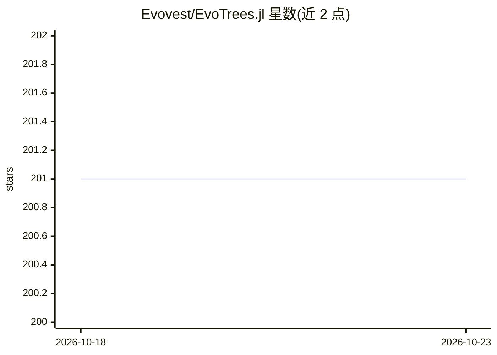

# Evovest/EvoTrees.jl

⭐ 201 · Julia · Apache-2.0 · 推送 2026-10-22 · [GitHub](https://github.com/Evovest/EvoTrees.jl) · [官网](https://evovest.github.io/EvoTrees.jl/dev/) · 组织维护

**Julia 实现的梯度提升树库，支持 CPU/GPU 训练**

EvoTrees.jl 是用 Julia 编写的梯度提升树机器学习库，采用基于直方图的高效算法，支持 CPU 与 GPU 训练，覆盖回归、分类、计数（Poisson）、多目标最大似然（EvoTreeMLE）等多种损失与模型构造器。接受 Matrix 与 DataFrames 输入，支持早停、类别特征（最多 255 层级）、精确 Shapley 值计算（Linear TreeShap）、特征重要度、树可视化与模型保存加载，另提供 R 绑定与 MLJ 集成。面向使用 Julia 生态的开发者与科研用户。

## 筛选速览

| 维度 | 判定 | 备注 |
|---|---|---|
| AI 角色 | `ai-native` | 本体是模型或模型工具 |
| 许可风险 | `permissive` | Apache-2.0 |
| 部署形态 | `None` |  |
| 模型依赖 | — | README 未给出锁定关系 |
| 硬件要求 | — | 无带数字的原话,不猜 |
| 安装摩擦 | `low` | 无编译、无系统依赖或容器化 |
| 成熟度 | — | 结构信号不足 |

## 能力要点

- CPU 与 GPU 训练支持，基于直方图算法
- 多损失函数含多目标最大似然（EvoTreeMLE）
- 精确 Linear TreeShap Shapley 值与特征重要度输出
- DataFrames 输入自动识别类别特征，提供 MLJ 集成与 R 绑定

## 适用场景

- 在 Julia 中训练梯度提升树做回归/分类/计数预测
- 用 Shapley 值与特征重要度解释树模型
- GPU 上大规模表格数据（千万行级）训练

## 场景标签

 · 领域:机器学习/表格数据建模

## 证据(README 行号)

> L7: A Julia implementation of boosted trees with CPU and GPU support.
> L8: Efficient histogram based algorithms with support for multiple loss functions (notably multi-target objectives such 

## 星数曲线

2026-10-18 201 → 2026-10-23 201（+0）

---
*卡片 v1 · prompt 1.4 · 生成 2026-10-22 · 置信度 high · 依据 README sha `2874446e9a11` · [字段定义](../../DATASET.md)*
