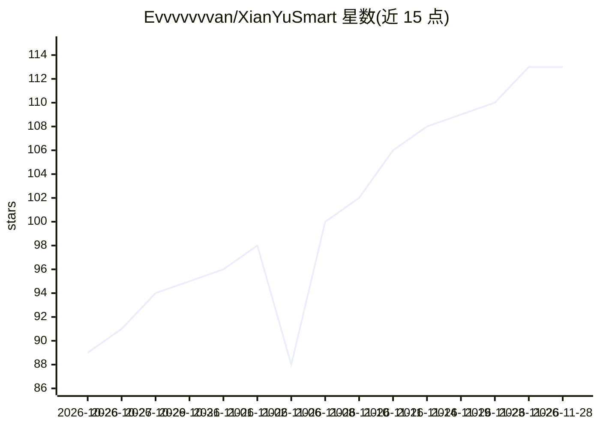

# Evvvvvvvan/XianYuSmart

⭐ 113 · Java · NOASSERTION · 推送 2026-11-26 · [GitHub](https://github.com/Evvvvvvvan/XianYuSmart) · 个人维护 · 中文 README

**给闲鱼虚拟商品商家的自动发货与 AI 客服运营系统**

面向多租户的闲鱼虚拟商品运营系统：买家下单后按商品自动交付固定内容或卡密，通过发货凭证与私聊双通道触达；咨询回复支持关键词、商品规则与基于向量知识库的 AI 客服，可人工接管。任务持久化、幂等入队、MySQL 行级锁预占库存，异常转人工复核；支持账号/商品/订单/知识库按租户隔离、Webhook 通知、Docker Compose 自部署。采用 PolyForm Noncommercial 1.0.0，禁止商业用途。

## 筛选速览

| 维度 | 判定 | 备注 |
|---|---|---|
| AI 角色 | `ai-enhanced` | 去掉 AI 部分产品仍成立 |
| 许可风险 | `none` | NOASSERTION |
| 部署形态 | `self-host` | docker 或自建部署 |
| 模型依赖 | local-ok | 支持本地模型 |
| 硬件要求 | — | 无带数字的原话,不猜 |
| 安装摩擦 | `low` | 无编译、无系统依赖或容器化 |
| 成熟度 | — | 结构信号不足 |

## 能力要点

- 固定内容与卡密两种互斥交付模式，行级锁预占防超卖
- 关键词、商品规则与 AI 知识库三种自动回复，支持人工接管
- 多租户数据隔离，AI 客服按租户配置独立客户端与向量库
- 内置 20 个 AI 服务商预设，支持 OpenAI 与 Anthropic 双协议

## 适用场景

- 自动出售网盘链接、教程等固定资源，免手动发货
- 自动发卡密并核销库存，避免重复发卡
- 用 AI 客服自动回复买家常见咨询
- 多商家共用平台时按租户隔离数据

## 场景标签

`RAG` `聊天机器人` · 领域:对话与助手

## 证据(README 行号)

> L17: XianYuSmart 是一个面向多租户场景的闲鱼虚拟商品运营系统。买家下单后，平台可以按商品自动交付固定资源或卡密，通过发货凭证、私聊或两种通道完成触达；成交前后的常见咨询、收货引导和评价跟进也能按规则自动处理。商家只需关注低库
> L71: |AI 客服可隔离|Spring AI、租户级动态客户端与独立向量库，支持关键词、商品规则和人工接管|AI 能力可按租户配置，也能随时回到确定性规则|
> L312: 「设置 → AI」内置 20 个服务商预设：OpenAI、Anthropic Claude、Google Gemini、DeepSeek、阿里云百炼 Qwen、月之暗面 Kimi、智谱 GLM、字节豆包（火山方舟）、腾讯混元、百

## 星数曲线

2026-10-26 89 → 2026-11-28 113（+24）

---
*卡片 v1 · prompt 1.4 · 生成 2026-11-28 · 置信度 high · 依据 README sha `93d0583dd664` · [字段定义](../../DATASET.md)*
