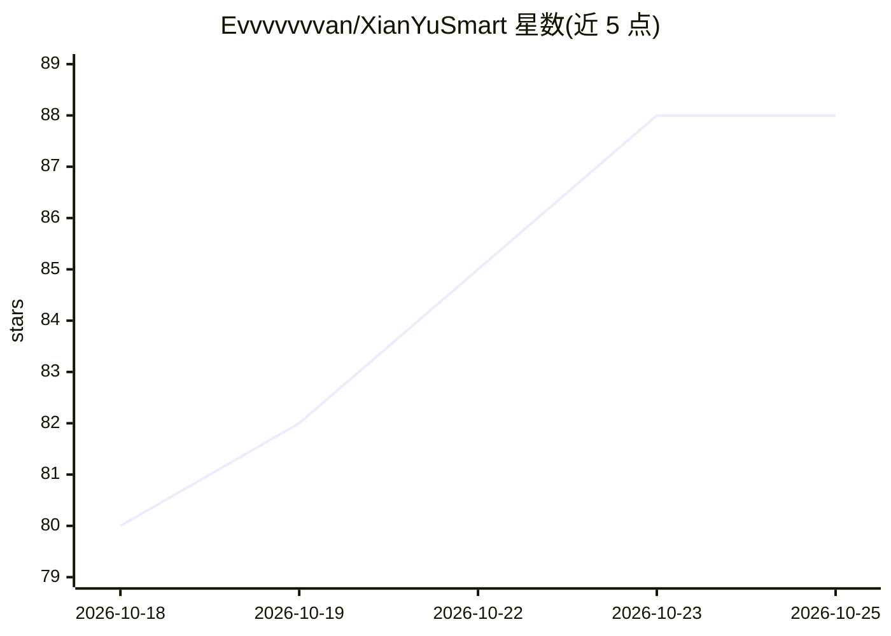

# Evvvvvvvan/XianYuSmart

⭐ 88 · Java · NOASSERTION · 推送 2026-10-22 · [GitHub](https://github.com/Evvvvvvvan/XianYuSmart) · 个人维护 · 中文 README

**闲鱼虚拟商品多租户自动化运营系统：发货、客服、售后一站式**

面向多租户的闲鱼虚拟商品运营系统，覆盖订单发现、幂等入队、库存预占、固定内容/卡密双模式交付、失败重试与人工复核的完整链路；支持关键词、商品规则与 AI 知识库（Spring AI、租户级向量库）自动回复及人工接管，并提供自动评价、买家管理、Webhook 通知与分销结算。技术栈为 Java 21、Spring Boot 3.5、Vue 3、MySQL、Flyway，核心链路只依赖 MySQL。采用 PolyForm Noncommercial 许可，禁止商业用途；通过 Docker Compose 自部署。

## 筛选速览

| 维度 | 判定 | 备注 |
|---|---|---|
| AI 角色 | `ai-enhanced` | 去掉 AI 部分产品仍成立 |
| 许可风险 | `none` | NOASSERTION |
| 部署形态 | `self-host` | docker 或自建部署 |
| 模型依赖 | — | README 未给出锁定关系 |
| 硬件要求 | — | 无带数字的原话,不猜 |
| 安装摩擦 | `low` | 无编译、无系统依赖或容器化 |
| 成熟度 | — | 结构信号不足 |

## 能力要点

- 卡密原子交付：MySQL 行级锁整单预占、成功核销、失败释放或转人工复核
- 订单与回复任务持久化，租约超时回收、退避重试，进程重启后可恢复
- 多租户数据隔离：账号、订单、库存、配置与 AI 知识库按租户隔离
- AI 客服基于 Spring AI 租户级动态客户端与独立向量库，支持人工接管

## 适用场景

- 虚拟商品商家自动发货卡密或固定内容，减少逐单复制粘贴
- 常见咨询自动回复，复杂会话人工接管
- 多商家共用一套自部署平台，数据互不串扰

## 场景标签

`聊天机器人` `工作流自动化` · 领域:效率与自动化

## 证据(README 行号)

> L17: XianYuSmart 是一个面向多租户场景的闲鱼虚拟商品运营系统。买家下单后，平台可以按商品自动交付固定资源或卡密，通过发货凭证、私聊或两种通道完成触达；成交前后的常见咨询、收货引导和评价跟进也能按规则自动处理。商家只需关注低库
> L71: |AI 客服可隔离|Spring AI、租户级动态客户端与独立向量库，支持关键词、商品规则和人工接管|AI 能力可按租户配置，也能随时回到确定性规则|

## 星数曲线

2026-10-18 80 → 2026-10-25 88（+8）

---
*卡片 v1 · prompt 1.4 · 生成 2026-10-23 · 置信度 high · 依据 README sha `9715d5fca273` · [字段定义](../../DATASET.md)*
