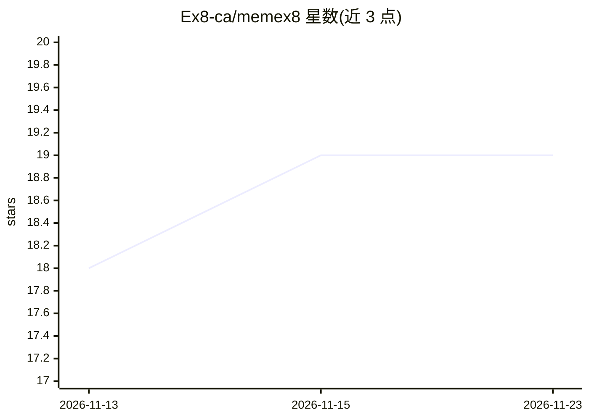

# Ex8-ca/memex8

⭐ 19 · Rust · MIT · 推送 2026-11-22 · [GitHub](https://github.com/Ex8-ca/memex8) · 个人维护

**自托管 AI agent 长期记忆系统：衰减/关联/夜间整合与 Web UI**

Rust 实现的 agent 记忆服务器，存储后端为 Qdrant，向量经 TurboQuant 压缩（8x）。机制包括按记忆类型的 Weibull 衰减、查询意图分类重排序、夜间 13 阶段 slumber 整合流水线（去重、聚类、语义关联、知识缺口检测、记忆验证）、可撤销的摘要合并（LLM 整合默认关闭）。面向 Hermes Agent（原生插件）、Claude Code/Codex（stdio MCP 桥）及任意 MCP 客户端，多客户端共享同一 REST API 与记忆库。嵌入支持 OpenAI、OpenAI 兼容端点与 Ollama 本地模型。部署依赖 Docker Compose，首启可容器内编译或用预构建镜像。

## 筛选速览

| 维度 | 判定 | 备注 |
|---|---|---|
| AI 角色 | `ai-ecosystem` | LLM/agent 周边工具 |
| 许可风险 | `permissive` | MIT |
| 部署形态 | `self-host` | docker 或自建部署 |
| 模型依赖 | local-ok | 支持本地模型 |
| 硬件要求 | — | 无带数字的原话,不猜 |
| 安装摩擦 | `low` | 无编译、无系统依赖或容器化 |
| 成熟度 | — | 结构信号不足 |

## 能力要点

- 13 种记忆类型各有 Weibull 衰减参数，0.05 保底不彻底删除
- 夜间 slumber 流水线：去重、聚类、关联、缺口检测、记忆验证
- TurboQuant 8x 压缩向量搜索，搜索路径无 LLM 调用（正则意图分类）
- Hermes 原生插件 + Claude Code/Codex MCP 桥 + Obsidian 只读检索

## 适用场景

- 为多个 AI 客户端（Hermes、Claude Code、Codex）提供共享长期记忆
- 让 agent 对话沉淀为可衰减、可关联、可验证的记忆库
- 本地网络内自托管记忆服务并通过 Web UI 管理与可视化

## 场景标签

`Agent 记忆` · 领域:Agent 开发

## 证据(README 行号)

> L30: Use one memex8 server from **Hermes Agent, Claude Code, and Codex**, on the same
> L136: - **MCP server** — works with Claude Code, Opencode, and any MCP-compatible agent
> L34: - **Hermes Agent:** native memory provider with automatic recall, conversation

## 星数曲线

2026-11-13 18 → 2026-11-23 19（+1）

---
*卡片 v1 · prompt 1.4 · 生成 2026-11-18 · 置信度 high · 依据 README sha `a2d4c2e6633f` · [字段定义](../../DATASET.md)*
