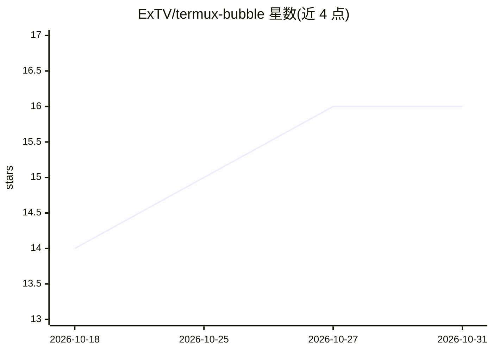

# ExTV/termux-bubble

⭐ 16 · Shell · GPL-3.0 · 推送 2026-10-24 · [GitHub](https://github.com/ExTV/termux-bubble) · 个人维护

**安卓全局悬浮的 DeepSeek AI 助手：剪贴板快捷操作+可执行 shell 命令的 agent 聊天**

纯 Termux + Termux:GUI bash 实现的 Android 悬浮气泡 AI 助手：气泡悬浮于所有应用之上，点按可用剪贴板快捷操作（翻译/摘要/解释/修复/回复），并提供 agentic 聊天，DeepSeek 可在设备上运行 bash 命令（读文件、抓取、运行程序）完成任务。API 端点可配置，兼容 llama.cpp/vLLM/Ollama/OpenRouter 等任何 OpenAI 兼容端点（需支持 tool calling）。命令执行可选确认，全部命令记录到 cmd.log；对话历史保存并重启恢复。

## 筛选速览

| 维度 | 判定 | 备注 |
|---|---|---|
| AI 角色 | `ai-native` | 本体是模型或模型工具 |
| 许可风险 | `viral` | GPL-3.0 |
| 部署形态 | `None` |  |
| 模型依赖 | local-ok | 支持本地模型 |
| 硬件要求 | — | 无带数字的原话,不猜 |
| 安装摩擦 | `low` | 无编译、无系统依赖或容器化 |
| 成熟度 | — | 结构信号不足 |

## 能力要点

- 悬浮于所有应用之上的剪贴板快捷操作（翻译/摘要/解释/修复/回复）
- agentic 聊天：模型可在设备上运行 bash 命令完成任务
- API 端点可配置，兼容任意 OpenAI 兼容本地/局域网模型服务器
- 命令执行确认开关与 cmd.log 全量命令审计，麦克风语音输入

## 适用场景

- 在其他应用中随时唤起 AI 处理剪贴板文本
- 让 AI 在手机本机执行命令完成实际任务
- 用本地模型服务器替代云端 API 运行助手

## 场景标签

`AI 助手` `聊天机器人` · 领域:对话与助手

## 证据(README 行号)

> L3: A floating AI assistant for Android, running entirely in Termux. A tiny draggable
> L5: explain, fix, reply) and an **agentic chat** where DeepSeek can run shell commands on

## 星数曲线

2026-10-18 14 → 2026-10-31 16（+2）

---
*卡片 v1 · prompt 1.4 · 生成 2026-10-30 · 置信度 high · 依据 README sha `e4742b9440e7` · [字段定义](../../DATASET.md)*
