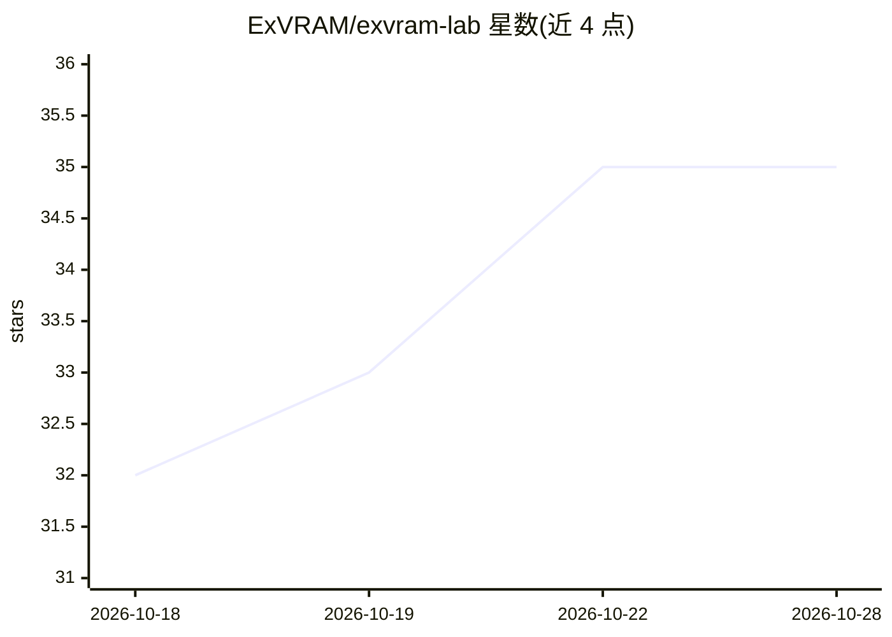

# ExVRAM/exvram-lab

⭐ 35 · Python · AGPL-3.0 · 推送 2026-10-24 · [GitHub](https://github.com/ExVRAM/exvram-lab) · [官网](https://exvram.pro) · 组织维护

**在 8GB 消费级 GPU 上运行 ~27B 大模型的研究实验框架**

开源研究项目，探索以 GPU 算力换显存的路径：组合超低比特量化（IQ2_XXS/q4_0 KV）、全 GPU 驻留与内存感知运行时配置，在 NVIDIA RTX 5060 8GB 上验证密集 ~27B 模型运行（已记录 65/65 层 CUDA、占用 8192 token 提示下中位解码 30.10 tok/s，质量门尚未运行）。本体是位于既有推理运行时（llama.cpp、ExLlamaV3、GemLite、Ollama 等）之上的适配器/基准/内存规划实验框架，不重写内核。以 Python 包（pip 源码安装 + CLI）提供，基础包不依赖 Torch 与 GPU。

## 筛选速览

| 维度 | 判定 | 备注 |
|---|---|---|
| AI 角色 | `ai-ecosystem` | LLM/agent 周边工具 |
| 许可风险 | `viral` | AGPL-3.0 |
| 部署形态 | `library` | 以包/库形式分发 |
| 模型依赖 | local-ok | 支持本地模型 |
| 硬件要求 | — | 无带数字的原话,不猜 |
| 安装摩擦 | `medium` | 含编译或系统依赖之一 |
| 成熟度 | `idea` | |

## 能力要点

- 适配器 + 基准 + 内存规划器架构，位于既有运行时之前而非替代
- 已验证里程碑：RTX 5060 8GB 上 65/65 层 CUDA、中位解码 30.10 tok/s
- 复用成熟开源实现优先，仅在实测差距存在时写第一方底层代码
- 输出带版本号的 JSON/JSONL 实验记录与研究 SQLite 数据库

## 适用场景

- 在 8GB 消费级 GPU 上跑通 ~27B 密集模型并记录可复现指标
- 对多种低比特量化方案做层级 CUDA 微基准与对比测量
- 跟踪显存受限推理研究路线（质量门、KV 量化、prefill/decode 分离）

## 场景标签

`模型量化` · 领域:训练与推理

## 证据(README 行号)

> L5: ExVRAM Lab is an open-source research project focused on running larger dense LLMs on memory-constrained consumer GP
> L109: ExVRAM Lab sits in front of existing runtimes. It does not replace them.
> L143: - `adapters/{exllamav3,gemlite,cutlass,bitnet,llamacpp,ollama,hqq,pbllm,billm}` — integration notes and boundaries

## 星数曲线

2026-10-18 32 → 2026-10-28 35（+3）

---
*卡片 v1 · prompt 1.4 · 生成 2026-10-25 · 置信度 high · 依据 README sha `0fd058507c09` · [字段定义](../../DATASET.md)*
