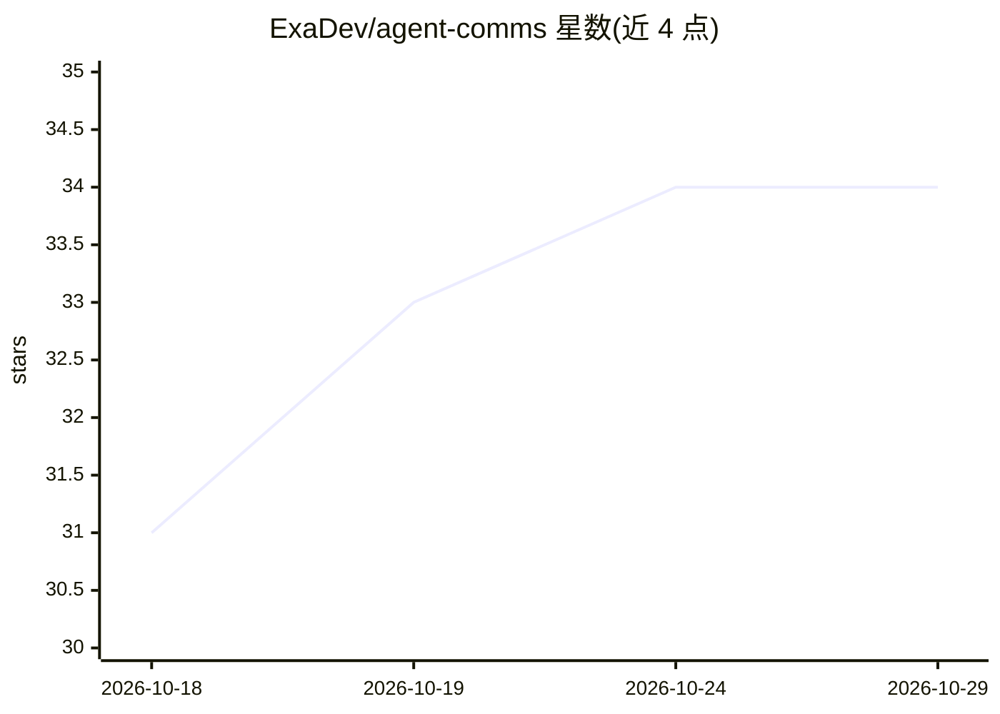

# ExaDev/agent-comms

⭐ 34 · TypeScript · MIT · 推送 2026-10-27 · [GitHub](https://github.com/ExaDev/agent-comms) · [官网](https://www.npmjs.com/package/agent-comms) · 个人维护

**跨 harness 的 LLM agent 通信网格：房间、私聊与在线状态**

面向 LLM agent 的本机 TCP 通信层：任意 harness（Claude Code、pi、Codex 等）中的 agent 通过桥接进程组成 localhost TCP 网格，可注册自身、发现其他 agent、加入房间、发送私信并协调工作。无守护进程、无文件系统依赖、无轮询；peer 间通过 UDP beacon 与公认端口 19876 发现彼此，coordinator 角色按 claim 选举负责机器级事务。身份基于本地生成的 ECDSA P-256 密钥，v2 版对 peer ID 派生方式有不兼容变更且无迁移路径。安装支持 pi/npm 与 git 源码方式。

## 筛选速览

| 维度 | 判定 | 备注 |
|---|---|---|
| AI 角色 | `ai-ecosystem` | LLM/agent 周边工具 |
| 许可风险 | `permissive` | MIT |
| 部署形态 | `library` | 以包/库形式分发 |
| 模型依赖 | — | README 未给出锁定关系 |
| 硬件要求 | — | 无带数字的原话,不猜 |
| 安装摩擦 | `low` | 无编译、无系统依赖或容器化 |
| 成熟度 | — | 结构信号不足 |

## 能力要点

- 本机 TCP mesh 连接不同 harness 中的 agent，支持房间、私聊、presence 与可见性
- 无守护进程、无文件系统总线、无轮询，状态存于内存并在 peer 间同步
- 离线期间的投递事件保存在复制队列中，agent 回归后重放
- 本地自签 ECDSA P-256 密钥派生 peer ID，重启后身份与房间成员关系保留

## 适用场景

- 让不同终端里的 Claude Code 与 pi 等 agent 互相发现并协作
- 多个 agent 加入同一房间协调任务分工
- 跨 harness 的 agent 之间点对点传递消息与工作成果

## 场景标签

`多智能体` · 领域:Agent 开发

## 证据(README 行号)

> L5: Cross-harness communication mesh for LLM agents: rooms, DMs, presence, and visibility over TCP with zero filesystem 
> L12: LLM agents on the same machine are isolated silos. A Claude Code session cannot see a pi session running in the nex
> L14: Agent Comms gives them one. Any agent, in any harness, can register itself, discover other agents, join rooms, send

## 星数曲线

2026-10-18 31 → 2026-10-29 34（+3）

---
*卡片 v1 · prompt 1.4 · 生成 2026-10-26 · 置信度 high · 依据 README sha `b6a5c2b0c8b1` · [字段定义](../../DATASET.md)*
