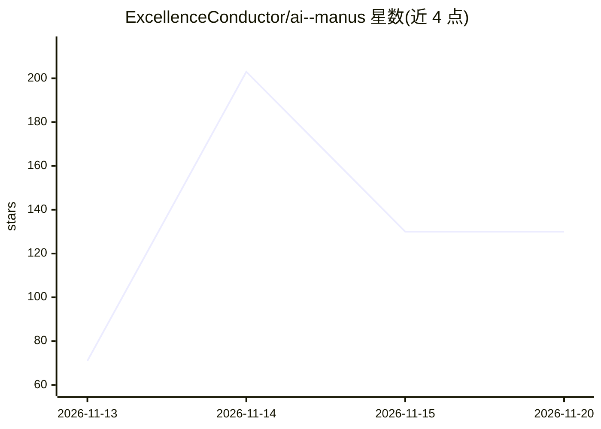

# ExcellenceConductor/ai--manus

⭐ 130 · Apache-2.0 · 推送 2026-11-15 · [GitHub](https://github.com/ExcellenceConductor/ai--manus) · 个人维护

**面向个人用户的自主 AI Agent：代跑代码与操作浏览器**

定位为家庭、学习与轻办公场景的自主 AI 代理：代替用户编写并执行脚本、控制浏览器（导航网页、填写表单、收集信息），并执行多步骤任务，可在后台持续待命并跨会话沿用相同流程。README 声明面向无需编程背景的用户，覆盖学习研究、家庭项目、轻办公与远程支持排查等场景。沙箱运行各类工具与操作。README 未给出具体安装命令、技术栈或模型接入细节，仅提供硬件兼容表与使用步骤说明。

## 筛选速览

| 维度 | 判定 | 备注 |
|---|---|---|
| AI 角色 | `ai-native` | 本体是模型或模型工具 |
| 许可风险 | `permissive` | Apache-2.0 |
| 部署形态 | `None` |  |
| 模型依赖 | — | README 未给出锁定关系 |
| 硬件要求 | — | 无带数字的原话,不猜 |
| 安装摩擦 | `low` | 无编译、无系统依赖或容器化 |
| 成熟度 | — | 结构信号不足 |

## 能力要点

- 自主执行代码与脚本完成多步任务
- 浏览器控制：导航、填表、抓取信息
- 后台常驻的个人助理模式，跨会话沿用流程
- 在沙箱环境中运行各类工具与操作

## 适用场景

- 让代理代为查网页、填表、收集资料
- 整理研究笔记、跑小脚本等学习与轻办公任务
- 远程支持时快速核对系统页面与诊断步骤

## 场景标签

`AI 助手` `浏览器自动化` · 领域:效率与自动化

## 证据(README 行号)

> L10: - **Autonomous Code Execution:** Manus AI agent runs code on its own to complete tasks, so you can focus on decisio
> L18: Manus is an autonomous AI agent designed to run code and control a browser on your behalf. Instead of acting like a

## 星数曲线

2026-11-13 71 → 2026-11-20 130（+59）

---
*卡片 v1 · prompt 1.4 · 生成 2026-11-17 · 置信度 mid · 依据 README sha `0f78ee3a5dd2` · [字段定义](../../DATASET.md)*
