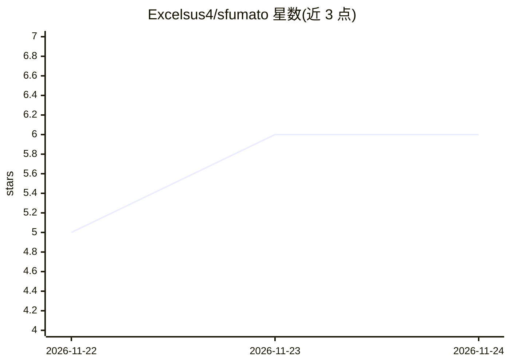

# Excelsus4/sfumato

⭐ 6 · Python · MIT · 推送 2026-11-21 · [GitHub](https://github.com/Excelsus4/sfumato) · 个人维护

**给 AI agent 的双轨跨域头脑风暴提示技能**

Sfumato 是一个以纯文本文件形式分发的 agent 技能（/sfumato、/sfm），用于在开放性问题上扩展 LLM 头脑风暴的探索多样性。其机制包括：用 Python RNG 从 74 个域/11 个聚簇中做极性感知抽样、Direct Anchor 保底、显式类比（Track A）与盲同构掩码（Track B）双轨并行求解、以及 Stage 2a/2b 的红队分诊与选择性加固。README 附带多问题与跨模型基准数据及复现脚本。依赖极少（声明零第三方依赖），支持在 Claude Code 上通过 --safe-profile claude 规避安全拒答。

## 筛选速览

| 维度 | 判定 | 备注 |
|---|---|---|
| AI 角色 | `ai-ecosystem` | LLM/agent 周边工具 |
| 许可风险 | `permissive` | MIT |
| 部署形态 | `None` |  |
| 模型依赖 | — | README 未给出锁定关系 |
| 硬件要求 | — | 无带数字的原话,不猜 |
| 安装摩擦 | `low` | 无编译、无系统依赖或容器化 |
| 成熟度 | — | 结构信号不足 |

## 能力要点

- 4 个纯文本文件、零外部 RAG、零微调、零第三方依赖
- 极性感知聚簇分层代码 RNG 域抽样（74 域 / 11 聚簇）
- Direct Anchor + 显式类比与盲同构掩码双轨隔离并行
- README 附基准数据与 python 复现脚本（tools/summarize_benchmarks.py）

## 适用场景

- 为开放式难题生成跨领域结构化备选方案
- 在 Claude Code 中按安全画像做头脑风暴
- 对比直接 Best-of-N 与结构化抽样提示的多样性产出

## 场景标签

`提示工程` `编码 Agent` · 领域:Agent 开发

## 证据(README 行号)

> L20: > **Sfumato** is an ultra-lightweight agent skill (`/sfumato`, `/sfm`) that does the same for frontier LLMs — **4 p
> L105: 1. **Polarity-Aware Cluster-Stratified Code RNG (`sample_domains.py`):** Never ask an LLM to "pick random domains"

## 星数曲线

2026-11-22 5 → 2026-11-24 6（+1）

---
*卡片 v1 · prompt 1.4 · 生成 2026-11-22 · 置信度 high · 依据 README sha `4d8603ae330b` · [字段定义](../../DATASET.md)*
