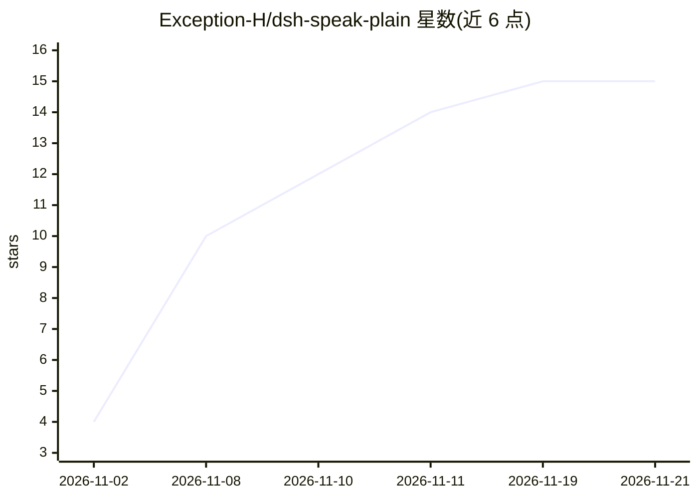

# Exception-H/dsh-speak-plain

⭐ 15 · JavaScript · MIT · 推送 2026-11-03 · [GitHub](https://github.com/Exception-H/dsh-speak-plain) · 个人维护 · 中文 README

**DSH 插件：把你选模型的最终回答润色成大白话**

面向 DSH（deepseek-harness）宿主的回答润色插件：在主模型完成回答后，调用用户在 DSH 已配置的渠道与模型对最终回答做表达层面的改写，默认显示润色版、原回答折叠可展开；通过保护标记保留代码围栏、行内代码与链接，并兼容 GenUI 组件渲染。插件不存储 API Key，复用 DSH 的模型路由，仅处理正常 stop、无工具调用的最后回答，超 6 万字符跳过，默认最多等待 60 秒。支持自动/手动两种润色模式，提供 GitHub、源码、tgz 三种安装方式。

## 筛选速览

| 维度 | 判定 | 备注 |
|---|---|---|
| AI 角色 | `ai-native` | 本体是模型或模型工具 |
| 许可风险 | `permissive` | MIT |
| 部署形态 | `library` | 以包/库形式分发 |
| 模型依赖 | — | README 未给出锁定关系 |
| 硬件要求 | — | 无带数字的原话,不猜 |
| 安装摩擦 | `low` | 无编译、无系统依赖或容器化 |
| 成熟度 | — | 结构信号不足 |

## 能力要点

- 默认显示润色版，原回答折叠并可随时展开
- 代码/链接保护标记机制，润色后校验还原
- 兼容 GenUI embed 组件渲染（dsh-ui 围栏）
- 自动与手动润色两种模式，不存储 API Key

## 适用场景

- 让 AI 助手的回答读起来更口语化、更易懂
- 按需对单段回答手动润色以节省模型额度
- 润色后仍需查看原始代码与链接的场景

## 场景标签

`AI 写作` · 领域:内容生成

## 证据(README 行号)

> L3: 让 DSH 的最终回答更容易听懂：用一个你选的模型润色最终回答，**默认显示润色版，原回答折叠、可随时点开查看**。主模型照常执行任务；润色只改表达，不改事实、条件与技术细节。
> L40: 插件不存储或索要 API Key，润色请求使用 DSH 已配置的模型路由，会额外消耗该模型的额度。发给润色模型的是最近一次用户提问、原回答中可改写的文字和你的表达偏好，不发送思考过程或完整工具日志。代码围栏、行内代码和 Markd

## 星数曲线

2026-11-02 4 → 2026-11-21 15（+11）

---
*卡片 v1 · prompt 1.4 · 生成 2026-11-18 · 置信度 mid · 依据 README sha `75147f6236bb` · [字段定义](../../DATASET.md)*
