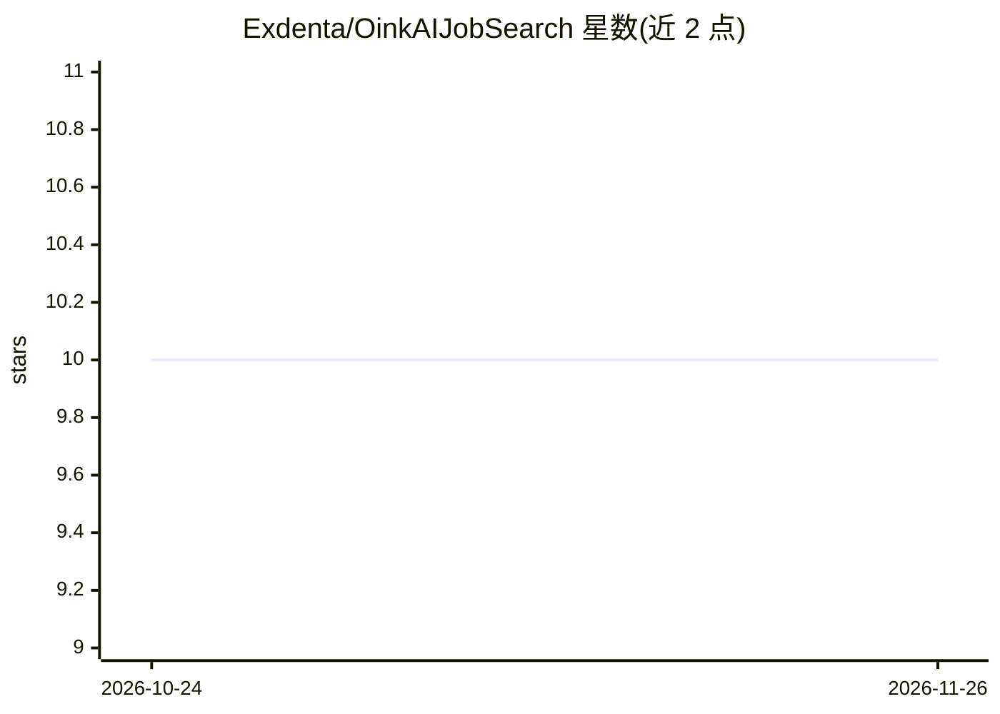

# Exdenta/OinkAIJobSearch

⭐ 10 · Python · NOASSERTION · 推送 2026-10-04 · [GitHub](https://github.com/Exdenta/OinkAIJobSearch) · [官网](https://oinkjobsearch.com) · 个人维护

**用 Claude 打分筛选职位的 Telegram 求职推送机器人**

自托管的 Python Telegram 机器人：抓取 25+ 求职来源（LinkedIn、HN Who is Hiring、Wellfound、EURES、学术与公益板等），用 Claude 对每条职位与用户简历打分，超过阈值才推送卡片，附招聘联系人查找与应用追踪按钮。支持由 Opus 重建用户画像、/marketresearch 并行 10 个 Opus 子代理生成 .docx 市场研究报告，历史存于本地 SQLite。AI 步骤经 claude -p 运行，需 Claude 订阅；仅限个人求职，抓取量刻意低频。

## 筛选速览

| 维度 | 判定 | 备注 |
|---|---|---|
| AI 角色 | `ai-native` | 本体是模型或模型工具 |
| 许可风险 | `none` | NOASSERTION |
| 部署形态 | `library` | 以包/库形式分发 |
| 模型依赖 | locked-api |  |
| 硬件要求 | — | 无带数字的原话,不猜 |
| 安装摩擦 | `low` | 无编译、无系统依赖或容器化 |
| 成熟度 | — | 结构信号不足 |

## 能力要点

- 抓取 25+ 求职来源，LLM 逐条打分替代关键词过滤
- Claude agent 查找招聘联系人并缓存判定结果
- /marketresearch 并行 10 个 Opus 子代理产出带目录与引用的 .docx 报告
- 本地 SQLite 记录已投递/跳过职位，支持用户级数据清除

## 适用场景

- 给自己和 Claude 订阅搭一个只推真匹配的求职提醒机器人
- 以研究者或公益行业身份订阅学术/UN 类职位来源
- 让 AI 生成针对某职位重排重点的简历备注
- 定期获得所在岗位的市场与薪酬研究报告

## 场景标签

`网页抓取` · 领域:效率与自动化

## 证据(README 行号)

> L5: **Oink scrapes 25+ sources, scores every posting against your resume with Claude, and pushes only the real matches t
> L32: - **Scrapes 25+ sources** — LinkedIn, HN "Who is Hiring", Wellfound, EURES, ReliefWeb, remote boards, EU tech board
> L34: - **Scores every posting with an LLM** — no keyword filters; a scoring prompt weighs each job against your profile,

## 星数曲线

2026-10-24 10 → 2026-11-26 10（+0）

---
*卡片 v1 · prompt 1.4 · 生成 2026-11-20 · 置信度 high · 依据 README sha `a42fe130bf63` · [字段定义](../../DATASET.md)*
