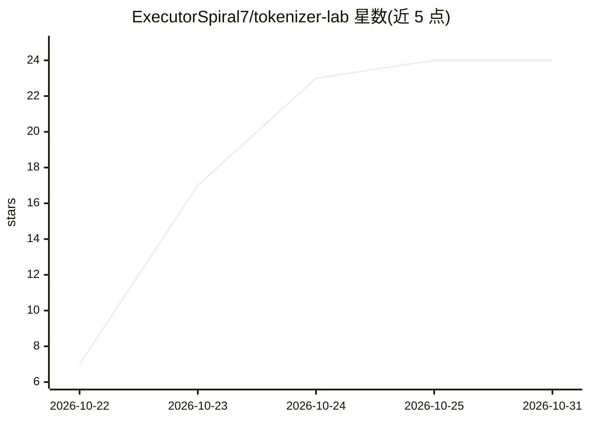

# ExecutorSpiral7/tokenizer-lab

⭐ 24 · C# · MIT · 推送 2026-10-18 · [GitHub](https://github.com/ExecutorSpiral7/tokenizer-lab) · 个人维护

**Windows 桌面 tokenizer 试验台：按 GGUF 模型分词计数比价**

面向本地 LLM 用户的 Windows 便携工具：读取 GGUF 文件头或 Hugging Face 目录中的真实 tokenizer 配置，对文本分词并以彩色 token 块展示；统计字符、词与 token 数并按每百万 token 计算成本字段；支持两个 tokenizer 并排对比同一文本、列出 BOS/EOS 等特殊 token 表、整文件夹批量计数。以 100 MB 自包含 exe 分发，离线运行，MIT 许可，Windows 10/11 x64；也可用 .NET 8 SDK 从源码构建。

## 筛选速览

| 维度 | 判定 | 备注 |
|---|---|---|
| AI 角色 | `ai-ecosystem` | LLM/agent 周边工具 |
| 许可风险 | `permissive` | MIT |
| 部署形态 | `None` |  |
| 模型依赖 | — | README 未给出锁定关系 |
| 硬件要求 | — | 无带数字的原话,不猜 |
| 安装摩擦 | `medium` | 含编译或系统依赖之一 |
| 成熟度 | — | 结构信号不足 |

## 能力要点

- 从 GGUF 头或 Hugging Face 目录读取真实 tokenizer 配置，非近似估算
- 两 tokenizer 并排对比同一文本，显示差值百分比
- 文件夹批量模式生成逐文件 token 计数表
- 100 MB 自包含便携 exe，离线、无广告、无遥测

## 适用场景

- 想知道一段文本在我的本地模型下占多少 token
- 对比两个模型的分词效率以选择省上下文的模型
- 批量估算一批文档的 token 数与 API 成本

## 场景标签

 · 领域:LLM 工具/桌面应用

## 证据(README 行号)

> L3: 🔡 Free, open-source tokenizer playground for Windows — tokenize text like any GGUF model, count tokens, compare two.
> L11: - ✅ **Loads real tokenizers** — reads tokenizer config from GGUF headers or Hugging Face folders, no approximations

## 星数曲线

2026-10-22 7 → 2026-10-31 24（+17）

---
*卡片 v1 · prompt 1.4 · 生成 2026-10-27 · 置信度 high · 依据 README sha `92ca9c650163` · [字段定义](../../DATASET.md)*
