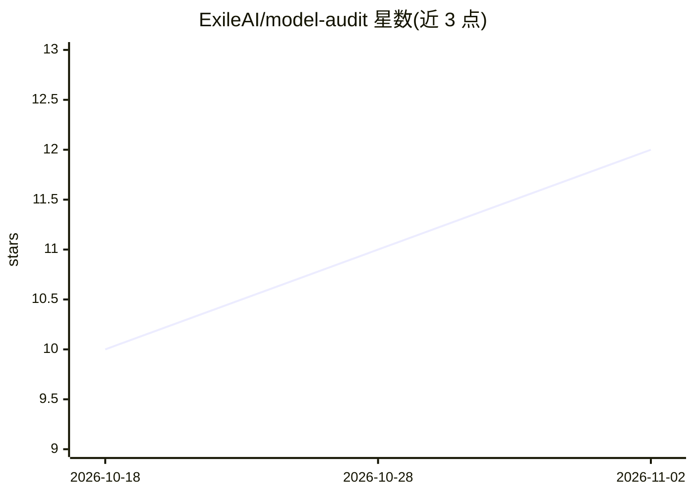

# ExileAI/model-audit

⭐ 12 · Python · MIT · 推送 2026-10-15 · [GitHub](https://github.com/ExileAI/model-audit) · 个人维护

**给普通用户的模型文件供应链审计工具：检查 GGUF/safetensors 是否被篡改**

面向下载 GGUF 或 safetensors 模型文件的用户（尤其 'uncensored'/abliterated 类小上传者作品）的命令行审计工具：自动识别文件格式，检查元数据、chat template 篡改签名、结构一致性、张量指纹基线对比与跨格式比对，可选 --hf 查询 Hugging Face 元数据。本地检查不上传文件；输出面向非技术读者的 HTML/JSON 报告与三级横幅（无红旗/警告/关键发现）。限制明确声明：无法证明模型安全，无数值安全分。需 Python 3.10+，源码 clone 安装。

## 筛选速览

| 维度 | 判定 | 备注 |
|---|---|---|
| AI 角色 | `ai-ecosystem` | LLM/agent 周边工具 |
| 许可风险 | `permissive` | MIT |
| 部署形态 | `library` | 以包/库形式分发 |
| 模型依赖 | — | README 未给出锁定关系 |
| 硬件要求 | — | 无带数字的原话,不猜 |
| 安装摩擦 | `low` | 无编译、无系统依赖或容器化 |
| 成熟度 | — | 结构信号不足 |

## 能力要点

- GGUF 与 safetensors 双格式审计，按文件首字节自动识别
- chat-template 篡改签名、结构一致性、张量指纹与跨格式比对检查
- 面向非技术读者的 HTML 报告，本地检查不上传文件
- 退出码 0/1/2 可供脚本分支，四维度证据评分（PASS/CONCERN/FAIL/NOT CHECKED/N/A）

## 适用场景

- 下载匿名上传者的量化模型后，加载前先检查是否被篡改
- 对同一底模维护张量指纹基线，检测权重块被替换或编辑
- 生成可读的 HTML 审计报告留存或分享

## 场景标签

`网络安全` · 领域:学习与行业

## 证据(README 行号)

> L9: `model-audit` is a supply-chain auditor for model files. You point it at a `.gguf` or
> L11: problems in the inputs it successfully inspects. It then prints a plain-language
> L20: - The report is written for non-technical readers, not for security engineers.

## 星数曲线

2026-10-18 10 → 2026-11-02 12（+2）

---
*卡片 v1 · prompt 1.4 · 生成 2026-11-02 · 置信度 mid · 依据 README sha `7d1071913df9` · [字段定义](../../DATASET.md)*
