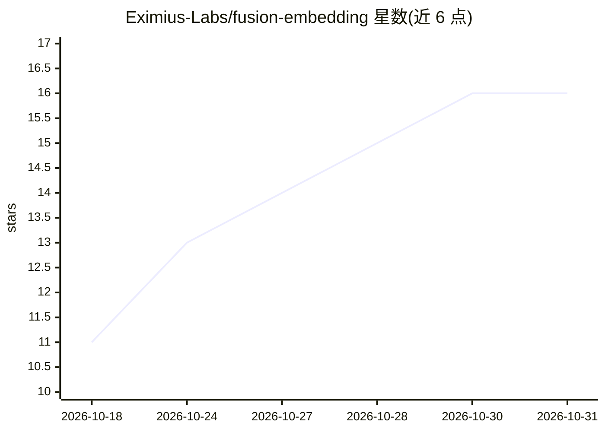

# Eximius-Labs/fusion-embedding

⭐ 16 · Python · Apache-2.0 · 推送 2026-08-05 · [GitHub](https://github.com/Eximius-Labs/fusion-embedding) · [官网](https://huggingface.co/EximiusLabs) · 组织维护

**开源权重多模态嵌入模型：七种模态统一到单一向量空间**

在冻结的 Qwen3-VL-Embedding 基座上增加音频通路（Qwen2.5-Omni 音频塔 + FusionResampler 连接器，gen2 再加模态门控适配器），把文本、图像、视频、音频、热成像、惯性运动、触觉映射到同一向量空间，供检索、RAG、聚类与跨模态搜索使用，可完全自托管。支持 Matryoshka 截断（2048→64 维）与音频任务指令前缀；新增传感器以单独加载的 sense pack 形式提供。已发布两个 2B preview 权重，8B 版为规划中。

## 筛选速览

| 维度 | 判定 | 备注 |
|---|---|---|
| AI 角色 | `ai-native` | 本体是模型或模型工具 |
| 许可风险 | `permissive` | Apache-2.0 |
| 部署形态 | `library` | 以包/库形式分发 |
| 模型依赖 | — | README 未给出锁定关系 |
| 硬件要求 | — | 无带数字的原话,不猜 |
| 安装摩擦 | `medium` | 含编译或系统依赖之一 |
| 成熟度 | `idea` | |

## 能力要点

- 冻结基座架构：仅训练音频侧组件（gen1 约 16M / gen2 60.6M 参数），非音频输入前向比特级不变
- 七模态单一向量空间，支持任意方向跨模态检索
- Matryoshka 嵌入可截断至 2048–64 任意档位，无需重新编码
- 音频任务指令前缀（sound/speech_content/music 等）与 RunPod 一键部署

## 适用场景

- 为多模态 RAG 与向量检索构建统一嵌入
- 用音频检索图像/文本（VGGSound 跨模态检索）
- 机器人/具身智能场景扩展热成像、惯性运动、触觉传感器嵌入

## 场景标签

`多模态` `语义搜索` · 领域:知识与检索

## 证据(README 行号)

> L19: Fusion Embedding is a family of open-weight embedding models that map **seven
> L21: inertial motion, and touch. It is built for retrieval, RAG, clustering and cross-modal
> L37: Qwen3-VL-Embedding — an

## 星数曲线

2026-10-18 11 → 2026-10-31 16（+5）

---
*卡片 v1 · prompt 1.4 · 生成 2026-10-30 · 置信度 high · 依据 README sha `a3486f3bc6c9` · [字段定义](../../DATASET.md)*
