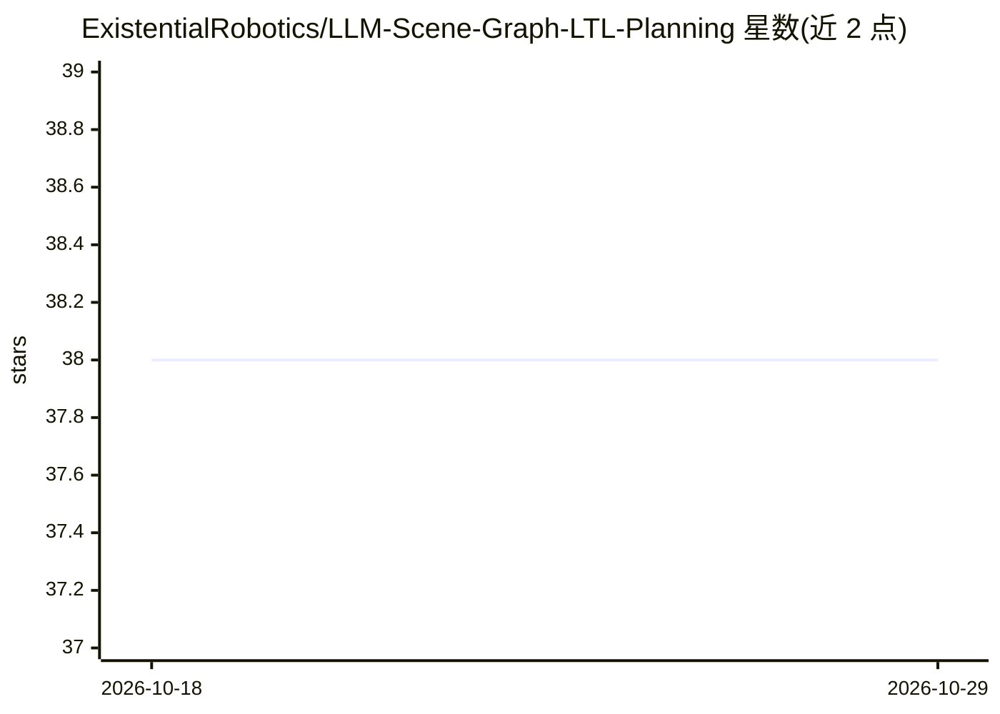

# ExistentialRobotics/LLM-Scene-Graph-LTL-Planning

⭐ 38 · C++ · 推送 2026-01-30 · [GitHub](https://github.com/ExistentialRobotics/LLM-Scene-Graph-LTL-Planning) · [官网](http://existentialrobotics.org/LLM-Scene-Graph-LTL-Planning/) · 组织维护

**ICRA'24 论文实现：LLM 引导的场景图 LTL 最优规划**

 accompanIEEE ICRA 2024 论文 Optimal Scene Graph Planning with Large Language Model Guidance 的官方实现，面向机器人规划研究者。流程为：从 Gibson 数据集提取场景图，用 GPT 将自然语言指令翻译为 LTL 公式，再由 GPT 生成启发式，供 C++ 实现的 AMRA* 规划器在分层规划域上求解并迭代至最优。需配置 OpenAI API key（GPT-4），云端调用受 API 延迟与 token 速率限制；翻译结果有时需人工修正。安装依赖较多（CMake/Eigen3/OpenCV/Boost/spot 等），Ubuntu 22.04 与 Arch Linux 提供一键安装脚本。

## 筛选速览

| 维度 | 判定 | 备注 |
|---|---|---|
| AI 角色 | `ai-native` | 本体是模型或模型工具 |
| 许可风险 | `none` | — |
| 部署形态 | `library` | 以包/库形式分发 |
| 模型依赖 | — | README 未给出锁定关系 |
| 硬件要求 | — | 无带数字的原话,不猜 |
| 安装摩擦 | `medium` | 含编译或系统依赖之一 |
| 成熟度 | — | 结构信号不足 |

## 能力要点

- 自然语言指令经 GPT 翻译为 LTL 公式并生成自动机（HOA 格式）
- GPT 生成 LLM 启发式，指导 AMRA* 在场景图分层域上规划至最优
- 从 Gibson 环境提取场景图（分割图/房间图/YAML 场景图）
- 提供预生成数据与各阶段脚本（提取/翻译/启发式/规划）

## 适用场景

- 复现论文中的场景图 LTL 规划实验
- 研究 LLM 启发式对最优运动规划的加速作用
- 基于 Gibson 环境做自然语言任务指令的机器人规划

## 场景标签

`科研工具` · 领域:学习与行业

## 证据(README 行号)

> L5: This repository contains an implementation accompanying the paper Optimal Scene Graph Planning with Large Language M
> L95: - You can run `./scripts/nl2ltl.bash` to generate the translation results used in the paper. Results are stored in
> L120: - You can run `./scripts/generate_llm_heuristic.bash` to generate the LLM heuristic used in the paper. Results are

## 星数曲线

2026-10-18 38 → 2026-10-29 38（+0）

---
*卡片 v1 · prompt 1.4 · 生成 2026-10-25 · 置信度 high · 依据 README sha `bb5ea8998d07` · [字段定义](../../DATASET.md)*
