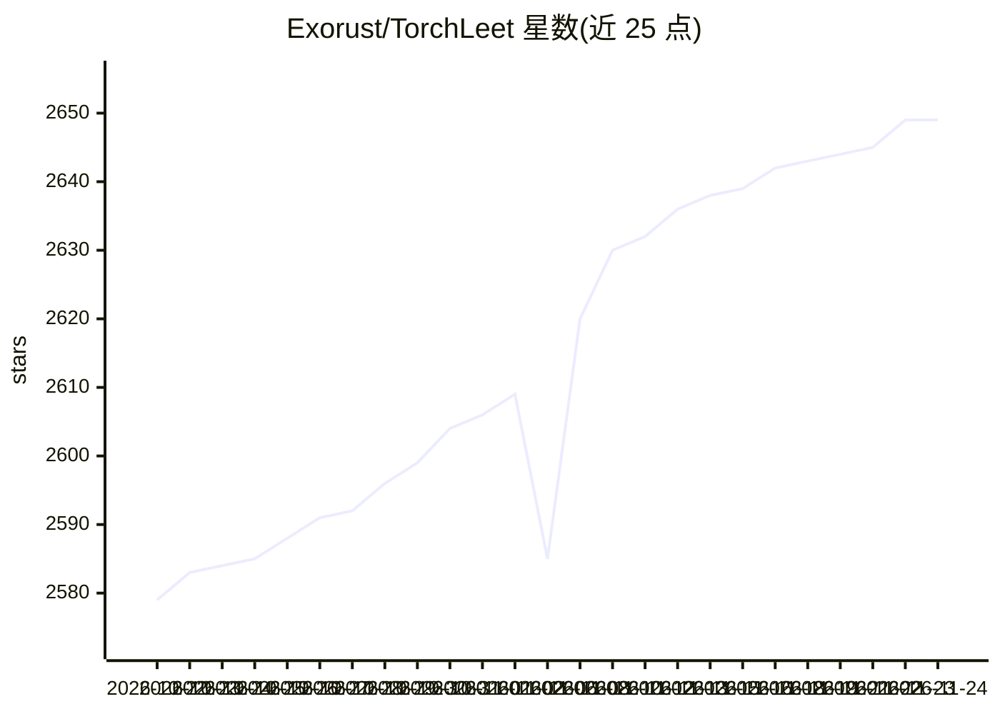

# Exorust/TorchLeet

⭐ 2,649 · Jupyter Notebook · MIT · 推送 2026-11-06 · [GitHub](https://github.com/Exorust/TorchLeet) · [官网](https://torch-leet.vercel.app) · 个人维护

**面向 ML/AI 求职者的 68 道真实面试 PyTorch 题集**

从 Google、Meta、Anthropic 等公司真实面试经历整理的 PyTorch 练习题集，以 Jupyter notebook 呈现，每题含问题文件与 _SOLN 解答文件，用户填写 TODO 后对照答案。按 Basics、LLM Learning Path、Advanced 三条轨道组织，覆盖注意力实现、LoRA/DPO/GRPO、采样解码、KV Cache、Triton 核等主题，并附按公司分类的优先题表。另提供 MCP server 形式的 AI Tutor，接入 Claude Desktop/Cursor 等助手后提供渐进提示与模拟面试，README 明确建议不要用 GPT 直接解答案。

## 筛选速览

| 维度 | 判定 | 备注 |
|---|---|---|
| AI 角色 | `ai-knowledge` | 知识聚合/清单类 |
| 许可风险 | `permissive` | MIT |
| 部署形态 | `None` |  |
| 模型依赖 | — | README 未给出锁定关系 |
| 硬件要求 | — | 无带数字的原话,不猜 |
| 安装摩擦 | `low` | 无编译、无系统依赖或容器化 |
| 成熟度 | — | 结构信号不足 |

## 能力要点

- 68 道题目分 Basics / LLM 学习路径 / Advanced 三条轨道，均配问题与解答 notebook
- 按公司标签（Google、Anthropic、OpenAI、DeepMind 等）给出优先练习题表
- MCP server 形式的 AI Tutor：渐进提示、模拟面试、代码点评、概念讲解四类指南
- LLM 学习路径按从零实现 SmolLM 的顺序编排基础到对齐推理的题目

## 适用场景

- 准备 ML/AI 工程师岗位的技术面试
- 按顺序从零实现一个 LLM 来系统学习 PyTorch
- 面试前按目标公司标签优先练习对应题目
- 借助 MCP AI Tutor 获取不泄露答案的渐进提示

## 场景标签

`教程课程` · 领域:学习与行业

## 证据(README 行号)

> L3: **68 PyTorch problems from real ML/AI interviews at Google, Meta, Anthropic, and more.**
> L48: 68 problems across three tracks:
> L15: ## AI Tutor (NEW)

## 星数曲线

2026-10-22 2,579 → 2026-11-24 2,649（+70）

---
*卡片 v1 · prompt 1.4 · 生成 2026-11-23 · 置信度 high · 依据 README sha `03c13f47747e` · [字段定义](../../DATASET.md)*
