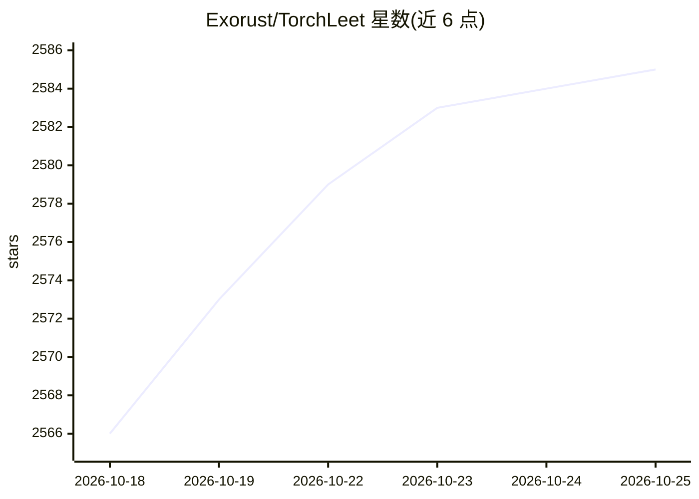

# Exorust/TorchLeet

⭐ 2,588 · Jupyter Notebook · MIT · 推送 2026-10-21 · [GitHub](https://github.com/Exorust/TorchLeet) · [官网](https://torch-leet.vercel.app) · 个人维护

**68 道 PyTorch/ML 面试实战题库，含 MCP AI 导师**

面向准备 ML/AI 工程师面试的开发者：收集据称来自 Google、Meta、Anthropic 等公司面试的 68 道 PyTorch 实操题，以 Jupyter notebook 形式提供题目文件与 _SOLN 解答文件，分 Basics、LLM 从零构建学习路径、Advanced 三条轨道，题目按公司标注优先级。另提供 MCP 服务器（torchleet-mcp，npm 发布），把任意 AI 助手（Claude Desktop/Cursor/VS Code）接入为渐进提示式导师，包含四种学习指南。README 明确建议不要直接用 GPT 求解。

## 筛选速览

| 维度 | 判定 | 备注 |
|---|---|---|
| AI 角色 | `ai-knowledge` | 知识聚合/清单类 |
| 许可风险 | `permissive` | MIT |
| 部署形态 | `None` |  |
| 模型依赖 | — | README 未给出锁定关系 |
| 硬件要求 | — | 无带数字的原话,不猜 |
| 安装摩擦 | `low` | 无编译、无系统依赖或容器化 |
| 成熟度 | — | 结构信号不足 |

## 能力要点

- 68 道题分三条轨道：基础、LLM 从零构建、高级专题
- 题目与解答 notebook 配对，含公司标签与优先级速查表
- MCP AI Tutor 提供渐进提示、模拟面试、代码评审四种指南
- 覆盖 LoRA/DPO/PPO/GRPO、FlashAttention-2、FSDP 等实现题

## 适用场景

- 我要系统准备 ML/AI 工程师面试的 PyTorch 手写题
- 按从零实现路线学习 Transformer 与 LLM 训练全流程
- 让 AI 助手以不剧透方式给我提示辅导刷题

## 场景标签

`教程课程` · 领域:学习与行业

## 证据(README 行号)

> L3: **68 PyTorch problems from real ML/AI interviews at Google, Meta, Anthropic, and more.**
> L17: Turn any AI assistant into your PyTorch interview coach. The TorchLeet MCP server gives your AI access to all 68 pr
> L41: |`torchleet-tutor`|Guides you through problems with progressive hints|

## 星数曲线

2026-10-18 2,566 → 2026-10-25 2,585（+19）

---
*卡片 v1 · prompt 1.4 · 生成 2026-10-21 · 置信度 high · 依据 README sha `7f1f60ca793b` · [字段定义](../../DATASET.md)*
