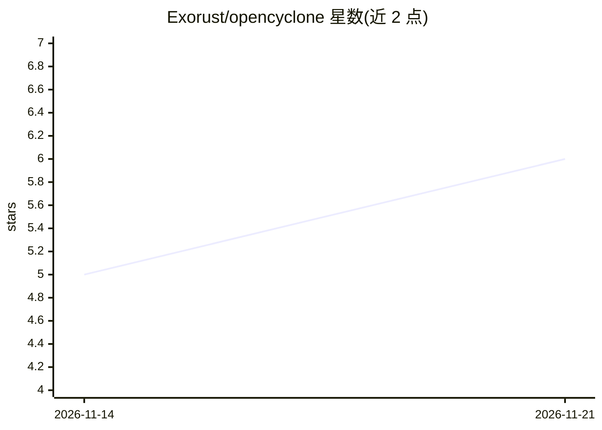

# Exorust/opencyclone

⭐ 6 · Kotlin · Apache-2.0 · 推送 2026-11-14 · [GitHub](https://github.com/Exorust/opencyclone) · [官网](https://opencyclone.vercel.app) · 个人维护

**在自有 Android 手机上代用户执行应用内任务的 AI agent**

面向普通 Android 手机的开源 agent：用户用语音或文字下达请求，agent 在隐藏显示器上以普通用户方式点击、输入，完成消息发送、通知处理、按请求生成小应用和小组件等任务。机制上每步向模型发送截图与编号的屏幕元素列表，模型返回一个动作；代码级审批门在 Send/Pay/Delete 类提交动作前强制暂停等待用户确认，模型无法绕过。需 Android 12+、adb 首次配对、支持图像与工具调用的模型；任务限 30 步或 10 分钟。

## 筛选速览

| 维度 | 判定 | 备注 |
|---|---|---|
| AI 角色 | `ai-native` | 本体是模型或模型工具 |
| 许可风险 | `permissive` | Apache-2.0 |
| 部署形态 | `None` |  |
| 模型依赖 | locked-api |  |
| 硬件要求 | — | 无带数字的原话,不猜 |
| 安装摩擦 | `medium` | 含编译或系统依赖之一 |
| 成熟度 | — | 结构信号不足 |

## 能力要点

- 隐藏显示器 + 无障碍服务代操作应用，可见屏幕不被占用
- 代码级审批门：提交类动作须用户确认，且批准前重读屏幕校验
- 本地语音识别为默认，模型可选 ChatGPT/OpenRouter/自有网络模型
- 银行、验证器、密码管理器类应用列入永不操作清单

## 适用场景

- 用一句话在聊天应用里代发消息
- 让手机自动整理一小时内收到的通知并生成待批准任务
- 按需求生成可分享的小应用并放到主屏

## 场景标签

`GUI 自动化` `AI 助手` · 领域:效率与自动化

## 证据(README 行号)

> L7: An open-source AI agent for a stock Android phone. You say or type what you need. The phone does it in your own apps
> L29: |Agent loop|Each step sends a picture and a numbered list of screen elements to the model. The model answers with o
> L30: |Approval gate|Code, not a prompt. It inspects every action before it runs. The model cannot skip it.|

## 星数曲线

2026-11-14 5 → 2026-11-21 6（+1）

---
*卡片 v1 · prompt 1.4 · 生成 2026-11-21 · 置信度 high · 依据 README sha `f178fec2cd5f` · [字段定义](../../DATASET.md)*
