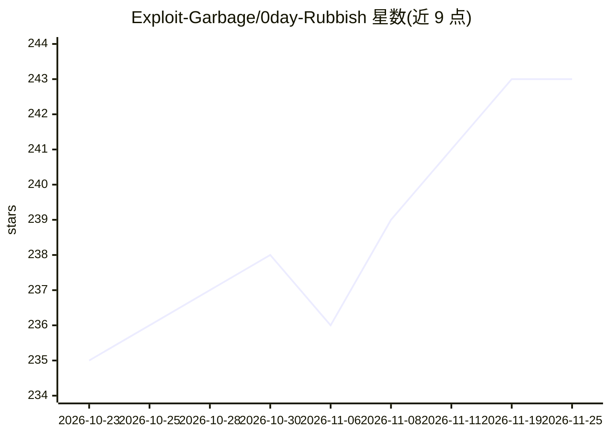

# Exploit-Garbage/0day-Rubbish

⭐ 243 · Python · MIT · 推送 2026-11-11 · [GitHub](https://github.com/Exploit-Garbage/0day-Rubbish) · [官网](http://0day-rubbish.com/) · 组织维护

**以 AI 批量发现并每周公开披露真实软件 0day 漏洞的仓库**

一个漏洞披露项目仓库：声明使用多 LLM 流水线（Claude/OpenAI/DeepSeek/GLM/Kimi）扫描真实企业软件，人工验证后编写可复现 PoC，按每周一批的节奏公开披露，每条含根因分析、漏洞利用代码、影响版本与缓解建议；截至 Batch 17 累计 155 条披露。仓库本身不提供可安装的软件，而是按 vendor/version/漏洞类型的目录结构组织漏洞披露条目，另附官网博客链接。

## 筛选速览

| 维度 | 判定 | 备注 |
|---|---|---|
| AI 角色 | `ai-knowledge` | 知识聚合/清单类 |
| 许可风险 | `permissive` | MIT |
| 部署形态 | `None` |  |
| 模型依赖 | — | README 未给出锁定关系 |
| 硬件要求 | — | 无带数字的原话,不猜 |
| 安装摩擦 | `low` | 无编译、无系统依赖或容器化 |
| 成熟度 | — | 结构信号不足 |

## 能力要点

- 每周批量披露经验证的 0day，累计 155 条（17 批）
- 多 LLM 集成的自动化漏洞发现流水线（Claude、OpenAI、DeepSeek、GLM、Kimi）
- 每条披露含根因分析、可用 PoC 代码与缓解建议
- 标准化的 vendor/version/漏洞类型目录与必需文件规范

## 适用场景

- 软件厂商据此检查自家产品是否在披露清单中并修补
- 安全研究人员查阅漏洞根因分析与 PoC
- 跟踪每周新增的漏洞披露批次

## 场景标签

`网络安全` · 领域:学习与行业

## 证据(README 行号)

> L25: Our automated AI systems continuously scan for vulnerabilities across real-world software, identifying potential 0-
> L31: Every week — Monday or Tuesday — we disclose a new batch of verified, exploitable 0-day vulnerabilities we've disco

## 星数曲线

2026-10-23 235 → 2026-11-25 243（+8）

---
*卡片 v1 · prompt 1.4 · 生成 2026-11-25 · 置信度 mid · 依据 README sha `3592507289a7` · [字段定义](../../DATASET.md)*
