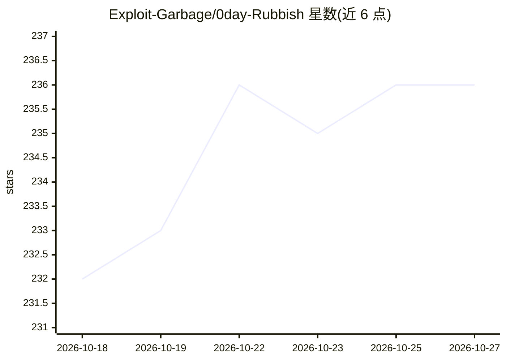

# Exploit-Garbage/0day-Rubbish

⭐ 236 · Python · MIT · 推送 2026-10-20 · [GitHub](https://github.com/Exploit-Garbage/0day-Rubbish) · [官网](http://0day-rubbish.com/) · 组织维护 · 中文 README

**每周批量公开经 AI 发现并验证的 0day 漏洞披露仓库**

安全研究披露项目：用多 LLM 组合（Claude、OpenAI、DeepSeek、GLM、Kimi）自动化扫描真实软件寻找 0day，经人工验证并开发可复现 PoC 后，每周一或二公开一批漏洞公告，每条含根因分析、受影响版本、CVSS 评分（附被否决的评分路径）、影响评估与缓解建议。面向安全研究人员与受影响厂商，采用事件驱动式直接披露模式，非营利，附官方网站。

## 筛选速览

| 维度 | 判定 | 备注 |
|---|---|---|
| AI 角色 | `ai-knowledge` | 知识聚合/清单类 |
| 许可风险 | `permissive` | MIT |
| 部署形态 | `None` |  |
| 模型依赖 | — | README 未给出锁定关系 |
| 硬件要求 | — | 无带数字的原话,不猜 |
| 安装摩擦 | `low` | 无编译、无系统依赖或容器化 |
| 成熟度 | — | 结构信号不足 |

## 能力要点

- 多 LLM 集成（Claude/OpenAI/DeepSeek/GLM/Kimi）自动化漏洞发现
- 每条披露附可工作的 PoC 利用代码与根因分析
- CVSS 评分同时公布被否决的备选评分及理由
- 每周固定批次公开，含受影响版本与缓解建议

## 适用场景

- 跟踪最新公开的企业软件 0day 漏洞与 PoC
- 安全研究人员参考多 LLM 漏洞发现流程与披露方法
- 厂商据此评估自家产品是否在受影响范围内

## 场景标签

`网络安全` · 领域:学习与行业

## 证据(README 行号)

> L31: Every week — Monday or Tuesday — we disclose a new batch of verified, exploitable 0-day vulnerabilities we've disco
> L69: An AI-driven research process (multi-LLM ensemble: Claude, OpenAI, DeepSeek, GLM, Kimi) discovers 0-days in real-wo

## 星数曲线

2026-10-18 232 → 2026-10-27 236（+4）

---
*卡片 v1 · prompt 1.4 · 生成 2026-10-22 · 置信度 high · 依据 README sha `447cace29f73` · [字段定义](../../DATASET.md)*
