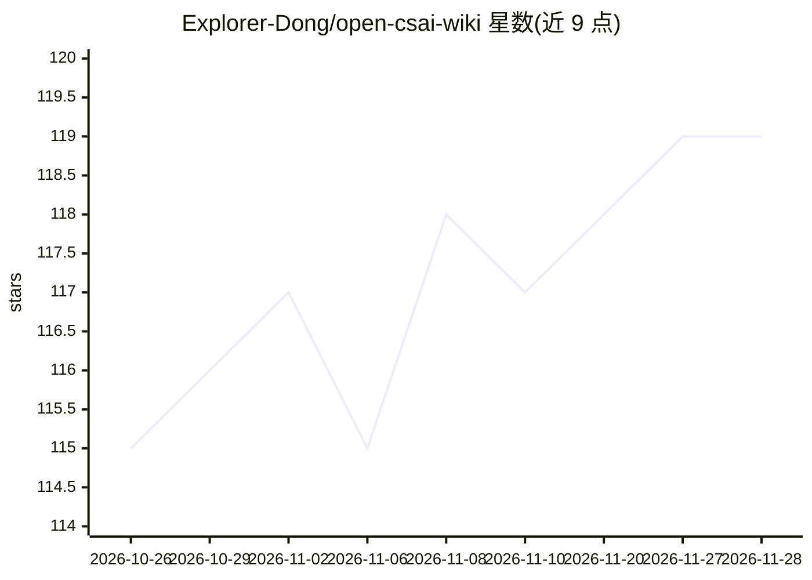

# Explorer-Dong/open-csai-wiki

⭐ 119 · MIT · 推送 2026-11-23 · [GitHub](https://github.com/Explorer-Dong/open-csai-wiki) · [官网](https://wiki.dwj601.cn) · 个人维护 · 中文 README

**面向学习者的开源 CS/AI 体系化知识笔记库**

个人维护的开源知识库（技术博客），围绕计算机与人工智能两大主题组织四个板块：基础知识（AI/计算机/数学）、数据结构与算法（动态规划、图论等）、软件开发（前端、后端、运维）、大模型（模型开发、训练、应用）。基于 Zensical 构建并提供在线浏览站点，接受社区贡献并采用 MIT 协议开源。

## 筛选速览

| 维度 | 判定 | 备注 |
|---|---|---|
| AI 角色 | `ai-knowledge` | 知识聚合/清单类 |
| 许可风险 | `permissive` | MIT |
| 部署形态 | `None` |  |
| 模型依赖 | — | README 未给出锁定关系 |
| 硬件要求 | — | 无带数字的原话,不猜 |
| 安装摩擦 | `low` | 无编译、无系统依赖或容器化 |
| 成熟度 | — | 结构信号不足 |

## 能力要点

- 四个板块覆盖计算机基础到大模型研究内容
- 提供在线浏览站点
- 接受社区贡献并公开协作者名单
- MIT 协议开源

## 适用场景

- 系统学习计算机科学与人工智能基础知识
- 查阅数据结构与算法笔记
- 了解大模型开发、训练与应用相关内容

## 场景标签

`教程课程` · 领域:学习与行业

## 证据(README 行号)

> L8:  开放 CS/AI 知识库，包括 基础知识、数据结构与算法、软件开发、大模型 等体系化的笔记
> L14: 本项目托管笔者的知识库（技术博客），围绕「计算机」与「人工智能」两大主题，展开以下四个板块：
> L19: - **大模型**：模型开发、模型训练、模型应用等研究内容。

## 星数曲线

2026-10-26 115 → 2026-11-28 119（+4）

---
*卡片 v1 · prompt 1.4 · 生成 2026-11-28 · 置信度 high · 依据 README sha `b9b5942d373b` · [字段定义](../../DATASET.md)*
