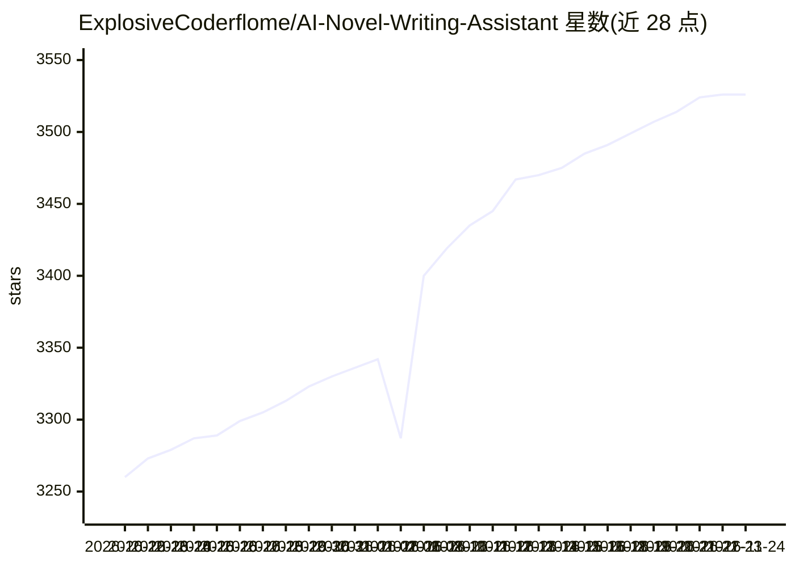

# ExplosiveCoderflome/AI-Novel-Writing-Assistant

⭐ 3,526 · TypeScript · NOASSERTION · 推送 2026-11-22 · [GitHub](https://github.com/ExplosiveCoderflome/AI-Novel-Writing-Assistant) · [官网](https://ai-novel-writing-assistant.mintlify.site/) · 个人维护 · 中文 README

**给小说作者的长篇 AI 创作工作台：从灵感到整本书**

面向长篇与短篇小说创作的 AI 工作台，提供自动导演工作流：整理题材与候选方向、分卷规划、逐章生成正文并检查保存。核心机制包括双版本导演（V1 分阶段入口 / V2 授权范围内全自动或按阶段确认推进）、世界与角色资料库、知识库 RAG 检索（依赖 Qdrant，可选启用）、写法引擎与反 AI 规则约束表达、拆书工作台复用参考作品。模型需用户自配 API，V2 单章默认 100,000 Tokens 用量上限。提供 Windows 桌面安装包与 pnpm 源码部署两种方式。

## 筛选速览

| 维度 | 判定 | 备注 |
|---|---|---|
| AI 角色 | `ai-native` | 本体是模型或模型工具 |
| 许可风险 | `none` | NOASSERTION |
| 部署形态 | `desktop` | 安装包/桌面程序 |
| 模型依赖 | — | README 未给出锁定关系 |
| 硬件要求 | — | 无带数字的原话,不猜 |
| 安装摩擦 | `low` | 无编译、无系统依赖或容器化 |
| 成熟度 | — | 结构信号不足 |

## 能力要点

- 自动导演工作流：开书方向选择、卷纲、章节任务、正文生成与逐章检查保存
- V2 支持全自动与按阶段确认两种推进方式，单章默认 100,000 Tokens 用量保护
- 知识库 RAG 检索（Qdrant + Embedding）配合世界、角色与写法组装章节上下文
- 写法引擎与反 AI 规则参与正文生成、检查与局部修文

## 适用场景

- 从一句灵感出发持续写出长篇小说章节
- 先拆解一本参考作品，再照其结构开新书
- 为同一本书维护世界观、人物与关系资料
- 把已有章节延展成漫画分镜或短剧素材

## 场景标签

`AI 写作` `RAG` · 领域:内容生成

## 证据(README 行号)

> L4:  Biz Novel Studio · 从一句灵感，走向一本完整小说
> L45: - **故事星图与开书方向**。每颗星都是一条灵感，可以从一颗星开书，也可以组合多颗。AI 会指出设定中的冲突，再给出两条不同的故事路线。可以分别讨论、逐项采纳，也可以保留前几轮再换一批。
> L74: |持续写出后续章节|V2 围绕授权范围推进近期规划、章节任务、场景、正文、检查与保存；V1 保留原工作流程|版本与模式说明|

## 星数曲线

2026-10-22 3,260 → 2026-11-24 3,526（+266）

---
*卡片 v1 · prompt 1.4 · 生成 2026-11-23 · 置信度 high · 依据 README sha `cd283d5ec208` · [字段定义](../../DATASET.md)*
