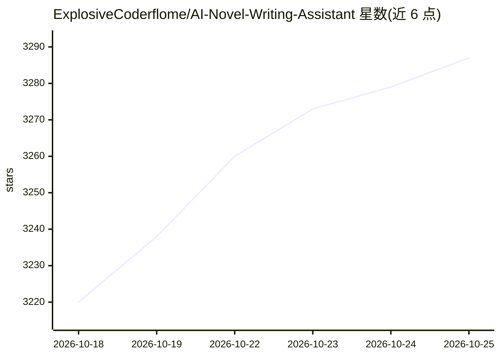

# ExplosiveCoderflome/AI-Novel-Writing-Assistant

⭐ 3,289 · TypeScript · NOASSERTION · 推送 2026-10-24 · [GitHub](https://github.com/ExplosiveCoderflome/AI-Novel-Writing-Assistant) · [官网](https://explosivecoderflome.github.io/AI-Novel-Writing-Assistant/) · 个人维护 · 中文 README

**面向长篇小说作者的 AI 创作工作台，从灵感到成书**

Biz Novel Studio 是开源 AI 小说创作工作台（Monorepo，React+Vite 前端、Express+Prisma 后端、LangChain/LangGraph 编排、Electron 桌面端）。提供 V1/V2 两代自动导演工作流推进长篇章节规划、生成、检查与保存，短篇走独立成稿流程；含世界手册、角色库、写法引擎与反 AI 规则、拆书分析、Qdrant+Embedding 的可选 RAG 知识库、Token 缓存优化与按章节/厂商/模型的用量统计，并支持为规划/正文/审阅/拆书分别路由模型。模型需用户自备 API 配置。Windows 提供安装版/便携版，源码经 pnpm 运行，AGPL-3.0 双许可证模式。

## 筛选速览

| 维度 | 判定 | 备注 |
|---|---|---|
| AI 角色 | `ai-native` | 本体是模型或模型工具 |
| 许可风险 | `none` | NOASSERTION |
| 部署形态 | `desktop` | 安装包/桌面程序 |
| 模型依赖 | — | README 未给出锁定关系 |
| 硬件要求 | — | 无带数字的原话,不猜 |
| 安装摩擦 | `low` | 无编译、无系统依赖或容器化 |
| 成熟度 | — | 结构信号不足 |

## 能力要点

- V1/V2 自动导演：长篇按授权范围连续规划、写正文、检查与保存，支持全自动与按阶段确认
- 世界手册/角色库/写法引擎/反 AI 规则参与生成与局部修文
- 知识库 RAG（Qdrant+Embedding，可选）与拆书分析复用参考资料
- 按章节/步骤/厂商/模型记录 AI 用量，稳定资料前置复用输入前缀

## 适用场景

- 第一次写小说的人从一个点子开始产出长篇/短篇
- 维护同一本书的世界、角色与章节状态并连续创作
- 拆解参考作品学习结构，并复用到自己的新书
- 研究 AI 创作流程并追踪模型调用消耗

## 场景标签

`AI 写作` · 领域:内容生成

## 证据(README 行号)

> L5:  AI 帮你规划世界与角色、逐章写作、检查和保存，让长篇创作有一条可以继续走下去的路。
> L30: 你只需要先有一个想法。这个工作台会帮你把方向、人物、世界和章节接起来，在创作过程中保留正文、设定与进度。长篇由自动导演持续推进，短篇走独立的完整成稿流程。它面向第一次写小说的人，也为需要维护长期资料、研究 AI 创作流程的作者与开
> L60: |写一篇完整短篇|从想法与方向选择进入 3,000—30,000 字短篇生产，连续阅读、修改和导出；也可另建长篇延展原故事|短篇使用路径|

## 星数曲线

2026-10-18 3,220 → 2026-10-25 3,287（+67）

---
*卡片 v1 · prompt 1.4 · 生成 2026-10-20 · 置信度 mid · 依据 README sha `39fa3f207431` · [字段定义](../../DATASET.md)*
