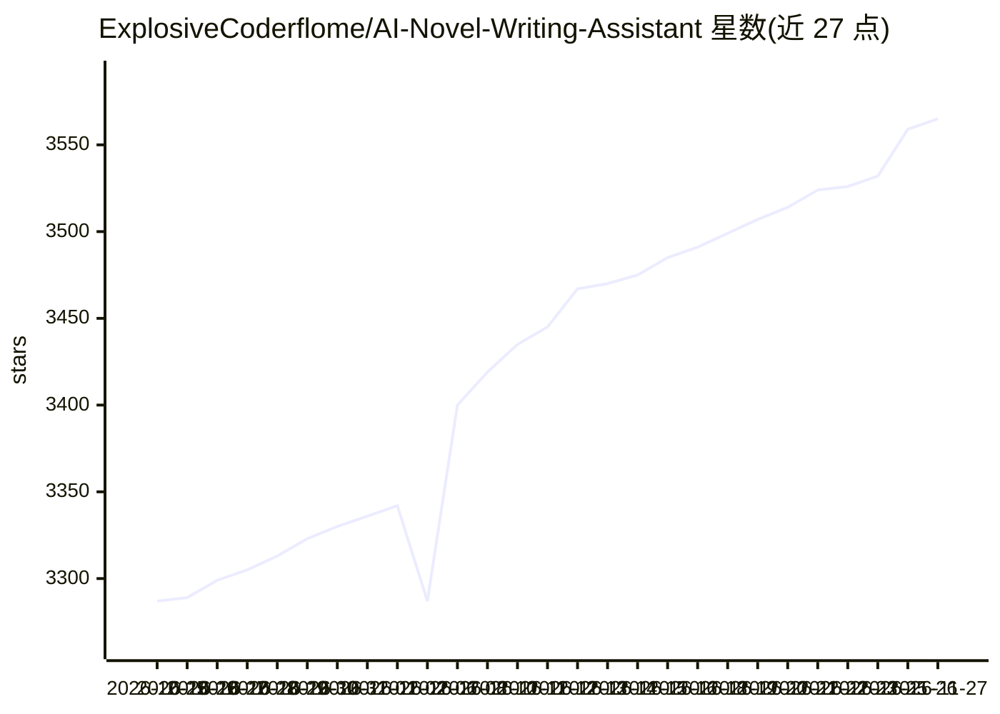

# ExplosiveCoderflome/AI-Novel-Writing-Assistant

⭐ 3,565 · TypeScript · AGPL-3.0 · 推送 2026-11-25 · [GitHub](https://github.com/ExplosiveCoderflome/AI-Novel-Writing-Assistant) · [官网](https://ai-novel-writing-assistant.mintlify.site/) · 个人维护 · 中文 README

**面向小说作者的长篇 AI 创作工作台，从灵感到全书**

一个面向长篇小说创作的 AI 工作台，提供自动导演开书、世界观与角色资料管理、逐章正文生成、章节检查与全书导出。导演分 V1/V2 两套流程，V2 支持全自动推进或按阶段人工确认；短篇走独立成稿流程。功能还包括写法引擎与反 AI 规则、拆书分析、RAG 知识库检索（可选 Qdrant）、模型路由与用量统计。提供 Windows 桌面安装包，也可克隆源码以 Node.js/pnpm 运行；模型需用户自配 API。

## 筛选速览

| 维度 | 判定 | 备注 |
|---|---|---|
| AI 角色 | `ai-native` | 本体是模型或模型工具 |
| 许可风险 | `viral` | AGPL-3.0 |
| 部署形态 | `desktop` | 安装包/桌面程序 |
| 模型依赖 | — | README 未给出锁定关系 |
| 硬件要求 | — | 无带数字的原话,不猜 |
| 安装摩擦 | `low` | 无编译、无系统依赖或容器化 |
| 成熟度 | — | 结构信号不足 |

## 能力要点

- 自动导演分 V1/V2 两套流程，支持全自动与按阶段确认两种推进方式
- 世界手册、角色库、拆书工作台维护长期创作资料，配合可选 Qdrant 做知识库 RAG 检索
- 写法引擎与反 AI 规则参与正文生成、检查和局部修文
- 模型路由按规划、正文、审阅、拆书分别配置供应商，附用量统计与单章 Token 上限保护

## 适用场景

- 从一句灵感出发，让 AI 规划方向并逐章推进长篇小说
- 维护同一本书的世界设定、人物关系和伏笔状态，保持长篇连贯
- 拆解参考作品的结构与写法，复用为新书资料
- 将已完成章节整理为漫画分镜或短剧素材

## 场景标签

`AI 写作` `RAG` `知识库管理` · 领域:内容生成

## 证据(README 行号)

> L3:  AI 小说创作工作台
> L5:  AI 帮你规划世界与角色、逐章写作、检查和保存，让长篇创作有一条可以继续走下去的路。
> L97: |让不同任务使用合适的模型|在页面配置供应商、连接测试与模型路由，为规划、正文、审阅、拆书分别选择模型|模型设置 · 模型路由|

## 星数曲线

2026-10-25 3,287 → 2026-11-27 3,565（+278）

---
*卡片 v1 · prompt 1.4 · 生成 2026-11-24 · 置信度 mid · 依据 README sha `5820e0e9ead3` · [字段定义](../../DATASET.md)*
