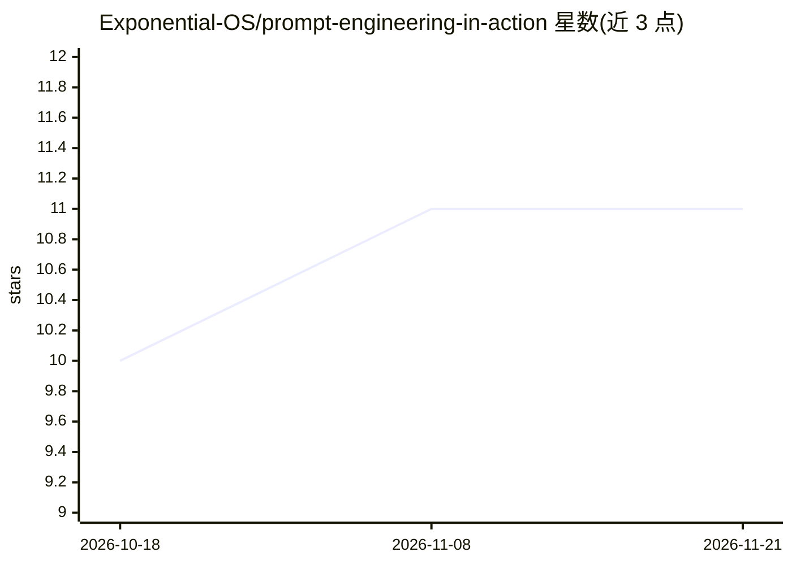

# Exponential-OS/prompt-engineering-in-action

⭐ 11 · TypeScript · AGPL-3.0 · 推送 2026-11-19 · [GitHub](https://github.com/Exponential-OS/prompt-engineering-in-action) · [官网](https://thewhyman.blog) · 个人维护

**面向 AI 对话用户的提示词优化与谄媚检测技能集**

以 SKILL.md 形式分发的提示词工程技能包，安装到 Claude Code、Cursor 等本地 AI 工具或网页聊天中。功能包括提示词实时改写（y/n/e 确认）、谄媚性检测与跨家族评审面板、上下文健康监控与崩溃恢复、专家 persona 调用、prompt 缓存以降低 token 消耗。提供 Full/Lite 两个版本区分付费档与免费档使用场景，通过插件市场或 shell 一行脚本安装。

## 筛选速览

| 维度 | 判定 | 备注 |
|---|---|---|
| AI 角色 | `ai-ecosystem` | LLM/agent 周边工具 |
| 许可风险 | `viral` | AGPL-3.0 |
| 部署形态 | `library` | 以包/库形式分发 |
| 模型依赖 | locked-api |  |
| 硬件要求 | — | 无带数字的原话,不猜 |
| 安装摩擦 | `low` | 无编译、无系统依赖或容器化 |
| 成熟度 | — | 结构信号不足 |

## 能力要点

- 会话内实时运行的谄媚检测与跨家族评审面板
- 提示词自动改写（y/n/e）与 prompt 缓存（约 250 token/次追问）
- 上下文健康监控（🟢/🟡/🔴）与崩溃自动保存恢复
- 10 个专家 persona 及多人格融合调用

## 适用场景

- 让 AI 助手持续改进我的提问方式而非一味附和
- 在 Cursor/Claude Code 编码会话中控制 token 开销
- 重要输出时引入跨模型家族的第二意见评审

## 场景标签

`提示工程` `模型评测` · 领域:Agent 开发

## 证据(README 行号)

> L7: ***An LLM prompt & context optimizer that saves tokens and recovers gracefully from chat crashes.***
> L9: Free. Open-source. Works with Claude, ChatGPT, Gemini — any AI.
> L25: |**Claude Code**|AI assistant in your terminal (`claude` command)|✅ Plugin install (recommended) — see below|

## 星数曲线

2026-10-18 10 → 2026-11-21 11（+1）

---
*卡片 v1 · prompt 1.4 · 生成 2026-11-19 · 置信度 low · 依据 README sha `492230253542` · [字段定义](../../DATASET.md)*
