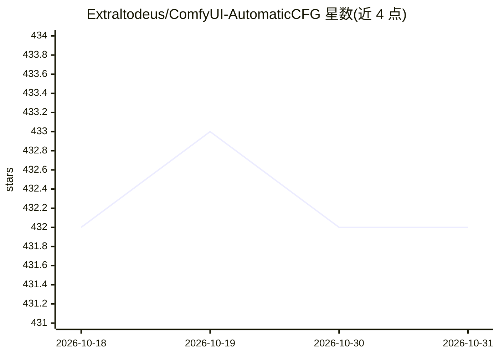

# Extraltodeus/ComfyUI-AutomaticCFG

⭐ 432 · Python · Apache-2.0 · 推送 2026-08-01 · [GitHub](https://github.com/Extraltodeus/ComfyUI-AutomaticCFG) · [官网](https://www.patreon.com/extraltodeus) · 个人维护

**ComfyUI 采样节点：自动重标定 CFG 防过曝并加速生成**

面向 ComfyUI / Stable Diffusion 用户的自定义节点集：核心功能是在采样每一步按潜在输出的最小/最大值自动重标定 CFG，防止图像过曝并减少伪影，同时将 CFG 数值转化为控制最终强度/亮度/饱和度的参数。附带 boost 开关（在 sigma 接近 1 时关闭负向引导以提速）、warp drive 节点（按自述平均提速 160%）、负向强度 lerp、attention 修改器与 preset loader。兼容 SDXL、SD3、Pixart Sigma 等模型。preset 以 .json 存在并通过 eval() 解释，运行他人 preset 存在代码执行风险。

## 筛选速览

| 维度 | 判定 | 备注 |
|---|---|---|
| AI 角色 | `ai-ecosystem` | LLM/agent 周边工具 |
| 许可风险 | `permissive` | Apache-2.0 |
| 部署形态 | `None` |  |
| 模型依赖 | — | README 未给出锁定关系 |
| 硬件要求 | — | 无带数字的原话,不猜 |
| 安装摩擦 | `low` | 无编译、无系统依赖或容器化 |
| 成熟度 | — | 结构信号不足 |

## 能力要点

- 逐步自动重标定 CFG，防止过曝与伪影
- boost / warp drive 功能声称最高约 160% 加速
- attention 修改器与大量 preset（多为 SDXL 测试）
- 支持 SDXL、SD3（不用 boost）、Pixart Sigma

## 适用场景

- 在 ComfyUI 中生成图像时避免高 CFG 导致的过曝
- 减少采样步数或关闭部分负向引导以缩短生成时间
- 通过 preset 试验不同 attention 修改效果

## 场景标签

`图像生成` · 领域:内容生成

## 证据(README 行号)

> L7: My own version "from scratch" of a self-rescaling CFG / anti-burn. It ain't much but it's honest work.
> L50: While this node is connected, this will turn your sampler's CFG scale into something else.
> L165: Thanks to ComfyUI for existing and making such things so simple!

## 星数曲线

2026-10-18 432 → 2026-10-31 432（+0）

---
*卡片 v1 · prompt 1.4 · 生成 2026-10-21 · 置信度 high · 依据 README sha `993d19a7f7c5` · [字段定义](../../DATASET.md)*
