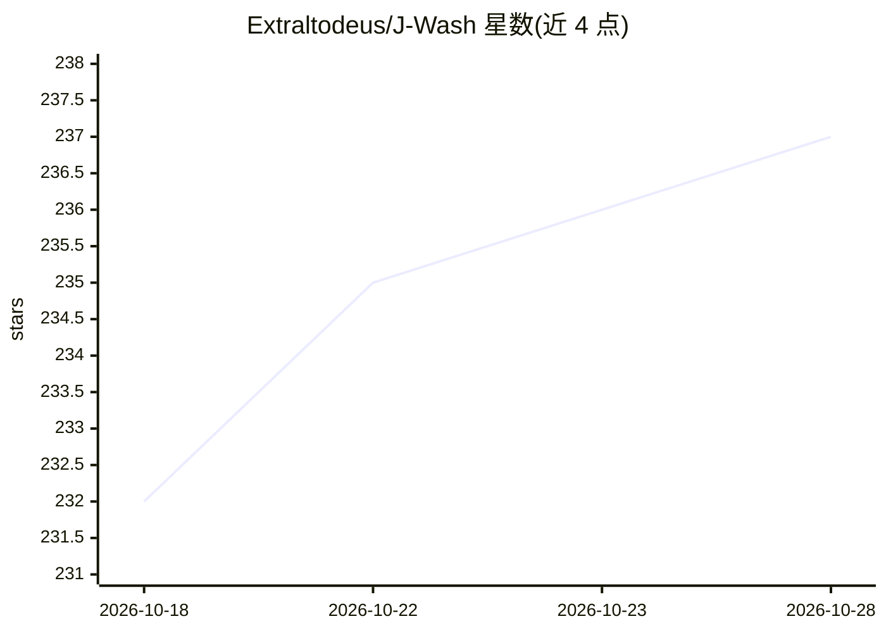

# Extraltodeus/J-Wash

⭐ 237 · Python · Apache-2.0 · 推送 2026-09-06 · [GitHub](https://github.com/Extraltodeus/J-Wash) · 个人维护

**本地 LLM 手动对齐工作室：编辑 token 方向并导出可用权重**

基于 Anthropic 的 Jacobian lens（jlens 库）构建的本地模型编辑工具（FastAPI + React）：在与任意 Hugging Face transformers/safetensors 模型对话时实时渲染各层读取的可视化（热图、token 云、rank 曲线），通过 token 编辑器添加 multiply/replace 规则修改模型身份或行为，并将编辑导出为 full checkpoint、修改层或 LoRA（标准 safetensors，可在 transformers 中加载），也可借助本地 llama.cpp 转换为 GGUF。支持自行在数据集上拟合 lens。要求 NVIDIA GPU（CUDA）、Python 3.11+、Node.js 18+。不支持直接加载 .gguf，量化权重上无法干预，Gemma 类模型受限。

## 筛选速览

| 维度 | 判定 | 备注 |
|---|---|---|
| AI 角色 | `ai-ecosystem` | LLM/agent 周边工具 |
| 许可风险 | `permissive` | Apache-2.0 |
| 部署形态 | `self-host` | docker 或自建部署 |
| 模型依赖 | local-ok | 支持本地模型 |
| 硬件要求 | — | 无带数字的原话,不猜 |
| 安装摩擦 | `low` | 无编译、无系统依赖或容器化 |
| 成熟度 | — | 结构信号不足 |

## 能力要点

- Jacobian lens 实时可视化各层读取，token 可固定检视
- token 级 multiply/replace 编辑规则，实时预览与导出一致（read projection）
- 导出 full checkpoint / 修改层 / LoRA，标准 safetensors 可随处加载
- 可指向本地 llama.cpp 目录将导出转换为 GGUF 并量化

## 适用场景

- 不训练、不微调地手工修改模型的自称身份或行为
- 结合可解释性视角探索模型各层在读什么
- 将手工编辑结果导出为可在任何运行时使用的独立模型

## 场景标签

 · 领域:LLM 可解释性/模型编辑

## 证据(README 行号)

> L9: J-Wash is a local studio (FastAPI + React) for exploring, editing the J-space
> L37: - and, the core feature, an **export pipeline** that bakes those edits into a
> L29: J-Wash is built on **Anthropic's Jacobian lens** (the

## 星数曲线

2026-10-18 232 → 2026-10-28 237（+5）

---
*卡片 v1 · prompt 1.4 · 生成 2026-10-22 · 置信度 high · 依据 README sha `39072a776a2c` · [字段定义](../../DATASET.md)*
