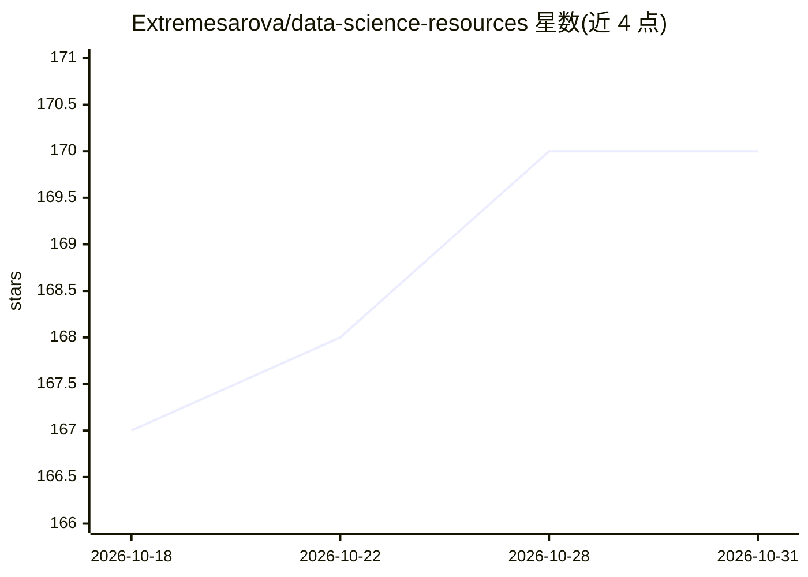

# Extremesarova/data-science-resources

⭐ 170 · 推送 2026-10-25 · [GitHub](https://github.com/Extremesarova/data-science-resources) · [官网](https://t.me/data_science_weekly) · 个人维护 · 中文 README

**数据科学面试与学习资源策展清单**

面向求职者与学习者的数据科学资源聚合清单：收录面试问答、算法与数据结构课程与练习平台、Python 教程与理论材料、行为面试建议、测试题与求职技巧等条目，条目来自 Terence Shin、Chip Huyen 等作者及多个平台，部分标注俄语内容。资源按目录分节组织，每周在 Telegram 频道 @data_science_weekly 对清单中一条资源做短评。不提供代码或工具，仅提供链接式条目。

## 筛选速览

| 维度 | 判定 | 备注 |
|---|---|---|
| AI 角色 | `ai-knowledge` | 知识聚合/清单类 |
| 许可风险 | `none` | — |
| 部署形态 | `self-host` | docker 或自建部署 |
| 模型依赖 | — | README 未给出锁定关系 |
| 硬件要求 | — | 无带数字的原话,不猜 |
| 安装摩擦 | `low` | 无编译、无系统依赖或容器化 |
| 成熟度 | — | 结构信号不足 |

## 能力要点

- 按面试问答/算法/Python/行为面试等分节组织条目
- 覆盖 Data Science、ML、Deep Learning、NLP/LLM、SQL 多方向面试资源
- 每周在 Telegram 频道对清单中一条资源做短评

## 适用场景

- 准备数据科学/机器学习岗位的面试问答
- 系统学习算法与数据结构及 Python
- 查找行为面试与求职技巧材料

## 场景标签

`精选清单` · 领域:学习与行业

## 证据(README 行号)

> L1: # Data Science Resources
> L3: For interview preparation and learning
> L12: ## Interview Preparation

## 星数曲线

2026-10-18 167 → 2026-10-31 170（+3）

---
*卡片 v1 · prompt 1.4 · 生成 2026-10-22 · 置信度 mid · 依据 README sha `b1bef4860bf0` · [字段定义](../../DATASET.md)*
