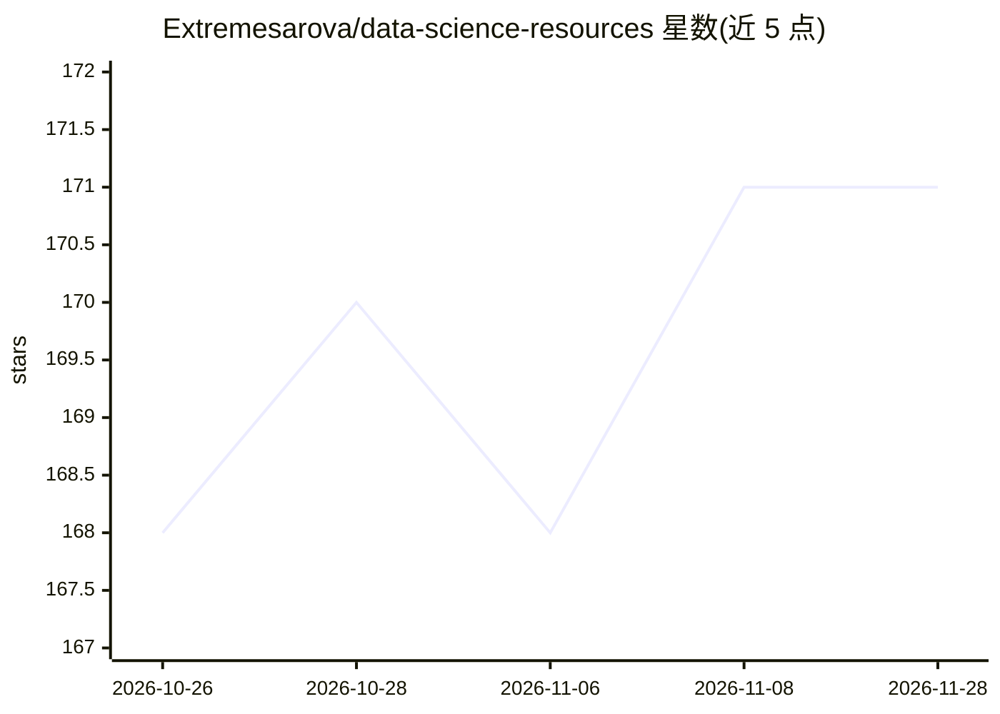

# Extremesarova/data-science-resources

⭐ 171 · 推送 2026-11-22 · [GitHub](https://github.com/Extremesarova/data-science-resources) · [官网](https://t.me/data_science_weekly) · 个人维护

**数据科学面试准备与学习资源清单**

面向数据科学/机器学习求职者的资源汇总清单，按面试准备（DS/ML/DL/SQL/NLP/编程/行为面试问题、家庭作业、经验建议）、算法与数据结构（平台、课程、书籍）、编程（Python 课程与理论）等类别组织条目。收录英文与俄文资源，部分条目标注 foundations/lang:rus 等标签。维护者每周日在 Telegram 频道发布一条资源的简短介绍。README 仅为链接列表，无安装或运行内容。

## 筛选速览

| 维度 | 判定 | 备注 |
|---|---|---|
| AI 角色 | `ai-knowledge` | 知识聚合/清单类 |
| 许可风险 | `none` | — |
| 部署形态 | `self-host` | docker 或自建部署 |
| 模型依赖 | — | README 未给出锁定关系 |
| 硬件要求 | — | 无带数字的原话,不猜 |
| 安装摩擦 | `low` | 无编译、无系统依赖或容器化 |
| 成熟度 | — | 结构信号不足 |

## 能力要点

- 按面试问题、课程、平台、书籍等类别组织的链接清单
- 覆盖 DS/ML/DL/SQL/NLP/行为面试多类面试准备材料
- 每周日在 Telegram 频道发布资源短评

## 适用场景

- 准备数据科学家/机器学习工程师面试时查找练习题与经验帖
- 系统学习 Python 与算法数据结构时挑选课程和书籍
- 准备外企求职时参考行为面试与英文面试材料

## 场景标签

`精选清单` · 领域:学习与行业

## 证据(README 行号)

> L1: # Data Science Resources
> L3: For interview preparation and learning
> L8: **Table of Contents**:

## 星数曲线

2026-10-26 168 → 2026-11-28 171（+3）

---
*卡片 v1 · prompt 1.4 · 生成 2026-11-26 · 置信度 mid · 依据 README sha `1ab18ef0bfbf` · [字段定义](../../DATASET.md)*
