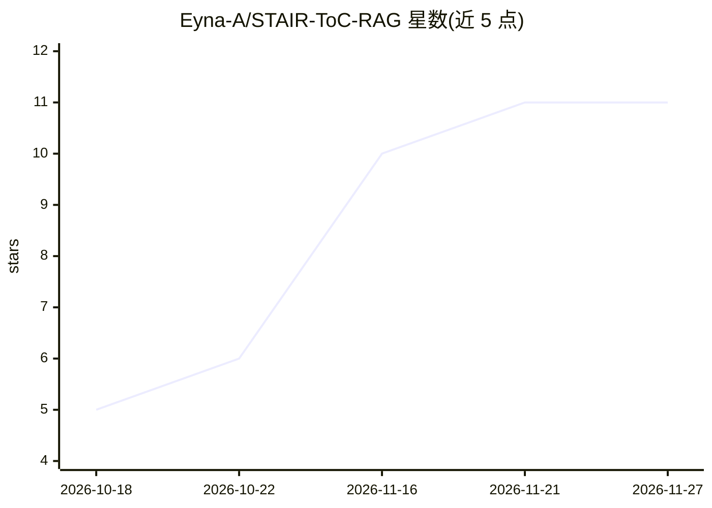

# Eyna-A/STAIR-ToC-RAG

⭐ 11 · Python · MIT · 推送 2026-09-09 · [GitHub](https://github.com/Eyna-A/STAIR-ToC-RAG) · 个人维护

**面向开发者的 ToC 结构感知 RAG 检索框架实现**

受 IBM STAIR 论文启发的开源实现：解析 PDF/DOCX/Markdown 提取目录树，将层级地址（章>节>段）注入嵌入内容，检索时结合向量搜索与父上下文扩展，结果附带可引用的层级路径。默认使用 Qdrant 向量库，可换 ChromaDB/FAISS；提供 FastAPI 的 /ingest 与 /query 接口及 Streamlit 仪表盘，支持 Docker Compose 部署。README 明确声明为独立非官方实现，与 IBM 及论文作者无关。

## 筛选速览

| 维度 | 判定 | 备注 |
|---|---|---|
| AI 角色 | `ai-ecosystem` | LLM/agent 周边工具 |
| 许可风险 | `permissive` | MIT |
| 部署形态 | `self-host` | docker 或自建部署 |
| 模型依赖 | — | README 未给出锁定关系 |
| 硬件要求 | — | 无带数字的原话,不猜 |
| 安装摩擦 | `low` | 无编译、无系统依赖或容器化 |
| 成熟度 | `idea` | |

## 能力要点

- ToC 树抽取：按标题/字体启发式解析为 章>节>段 层级
- 层级地址注入嵌入（"[Path] | Content"），检索结果附可引用路径
- 向量检索 + Parent-Context Expansion 保留上游上下文
- FastAPI 接口与 Streamlit 仪表盘，Docker Compose 一键部署

## 适用场景

- 对手册、合同、论文等长结构化文档做按结构寻址的检索
- 为内部知识库构建带引用路径的问答服务
- 作为 RAG 流水线中替换朴素分块的检索层

## 场景标签

`RAG` `文档解析` `文档问答` · 领域:知识与检索

## 证据(README 行号)

> L17: **STAIR-ToC-RAG** is a document-native retrieval framework inspired by the IBM Research paper:
> L33: - 🧠 **ToC-Aware Retriever** — vector search + **Parent-Context Expansion** to avoid losing upstream context.
> L35: - 🌐 **REST API** — FastAPI `/ingest` and `/query` endpoints.

## 星数曲线

2026-10-18 5 → 2026-11-27 11（+6）

---
*卡片 v1 · prompt 1.4 · 生成 2026-11-20 · 置信度 high · 依据 README sha `060544e24ec5` · [字段定义](../../DATASET.md)*
