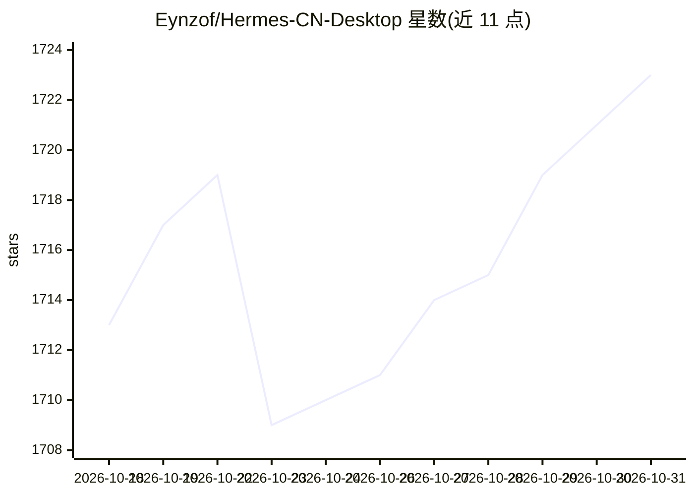

# Eynzof/Hermes-CN-Desktop

⭐ 1,723 · TypeScript · NOASSERTION · 推送 2026-09-21 · [GitHub](https://github.com/Eynzof/Hermes-CN-Desktop) · [官网](https://hermesagent.org.cn) · 组织维护 · 中文 README

**Hermes Agent 中文社区桌面客户端，托管 Agent 内核与运行时**

基于 Tauri v2、Rust、React 和 TypeScript 构建的桌面端外壳，为 Hermes Agent 中文社区版（Hermes-CN-Core 内核）提供原生窗口、本地进程管理、托管运行时安装/更新/签名校验/回滚、运行时诊断，以及生产模式下的 REST 代理与 WS 中继。UI 覆盖聊天、流式输出、MCP 工具、Skills、Memory、定时任务等，支持配置云端模型服务商与 Ollama、vLLM、LM Studio、llama.cpp 本地端点。面向 Windows 与 macOS 用户，当前版本 v0.8.0-rc8，仍在快速迭代。许可证为 PolyForm NC 1.0.0，商业使用需单独授权。

## 筛选速览

| 维度 | 判定 | 备注 |
|---|---|---|
| AI 角色 | `ai-ecosystem` | LLM/agent 周边工具 |
| 许可风险 | `none` | NOASSERTION |
| 部署形态 | `desktop` | 安装包/桌面程序 |
| 模型依赖 | local-ok | 支持本地模型 |
| 硬件要求 | — | 无带数字的原话,不猜 |
| 安装摩擦 | `low` | 无编译、无系统依赖或容器化 |
| 成熟度 | `idea` | |

## 能力要点

- 内置独立 Hermes Agent 内核：安装、更新、签名校验、健康检查与回滚
- 面向 Agent 的完整 UI：聊天、MCP 工具、Skills、Memory、LaTeX/Mermaid 渲染
- 生产模式 Rust command 代理 REST 与 WS 中继
- 支持 Ollama、vLLM、LM Studio、llama.cpp 本地模型端点配置

## 适用场景

- Windows/macOS 上一键安装并使用 Hermes Agent，免手动配置运行时
- 通过桌面界面管理聊天、Skills、Memory 与模型服务商配置
- 本地运行与诊断 Hermes Agent 内核健康状态

## 场景标签

`AI 助手` · 领域:对话与助手

## 证据(README 行号)

> L84: Hermes Agent 已经提供本地 Dashboard。本仓库专注于 Dashboard 之外的桌面体验：原生窗口、本地进程管理、文件对话框、托管运行时安装、运行时诊断，以及生产模式下更安全的 REST 代理层与必要时的 WS
> L92: - **内置独立 Hermes Agent 内核**：桌面端支持安装、更新、签名校验、健康检查和回滚本地 Hermes Agent 内核。

## 星数曲线

2026-10-18 1,713 → 2026-10-31 1,723（+10）

---
*卡片 v1 · prompt 1.4 · 生成 2026-10-21 · 置信度 mid · 依据 README sha `d64335d6e209` · [字段定义](../../DATASET.md)*
