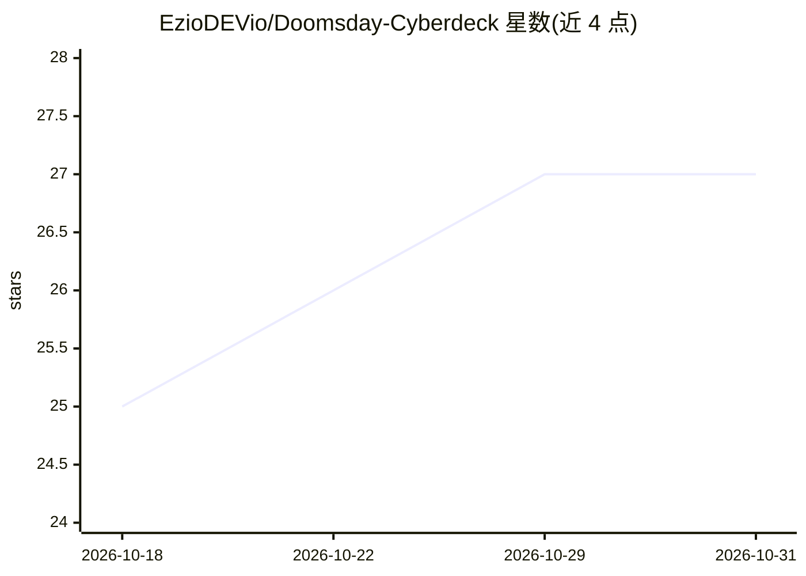

# EzioDEVio/Doomsday-Cyberdeck

⭐ 27 · MIT · 推送 2026-10-11 · [GitHub](https://github.com/EzioDEVio/Doomsday-Cyberdeck) · 个人维护

**基于树莓派5的离线生存电脑DIY项目，带离线AI助手**

自制便携离线计算机项目：以树莓派5（16GB RAM）为核心，装在 Pelican V200 硬箱中，配备10.1寸触屏、256GB MicroSD + 2TB NVMe 存储、Geekworm X1202 UPS（支持市电/太阳能充电与4节18650热插拔）。内容层提供 Kiwix 离线维基百科、生存手册 PDF、离线开发文档与媒体库；AI 部分通过本地 LLM（如 DeepSeek 32B）运行离线聊天机器人，用例包括技术支持、生存问答与自然语言查询离线文档。仓库提供 3D 模型、接线图与脚本，需自行硬件组装。

## 筛选速览

| 维度 | 判定 | 备注 |
|---|---|---|
| AI 角色 | `ai-enhanced` | 去掉 AI 部分产品仍成立 |
| 许可风险 | `permissive` | MIT |
| 部署形态 | `None` |  |
| 模型依赖 | locked-api |  |
| 硬件要求 | — | 无带数字的原话,不猜 |
| 安装摩擦 | `low` | 无编译、无系统依赖或容器化 |
| 成熟度 | — | 结构信号不足 |

## 能力要点

- 本地 LLM（DeepSeek 32B 等）驱动的离线 AI 聊天助手
- UPS 双输入供电，支持太阳能充电与 18650 电池热插拔
- Kiwix 全量离线维基百科与生存/技术文档库
- 3D 模型、接线图与构建文档开源，可自行 3D 打印组装

## 适用场景

- 断网/停电等应急场景下访问离线知识与媒体
- 户外或无电网环境用太阳能供电运行本地 AI 问答
- 按开源图纸自行复刻一台便携离线工作站

## 场景标签

`聊天机器人` · 领域:对话与助手

## 证据(README 行号)

> L26: And now, an offline AI assistant running a powerful LLM (DeepSeek 32B or higher), ready to help with coding, troubl
> L127: 🧠 AI Integration
> L130: DeepSeek 32B

## 星数曲线

2026-10-18 25 → 2026-10-31 27（+2）

---
*卡片 v1 · prompt 1.4 · 生成 2026-10-26 · 置信度 high · 依据 README sha `0c09039045b9` · [字段定义](../../DATASET.md)*
