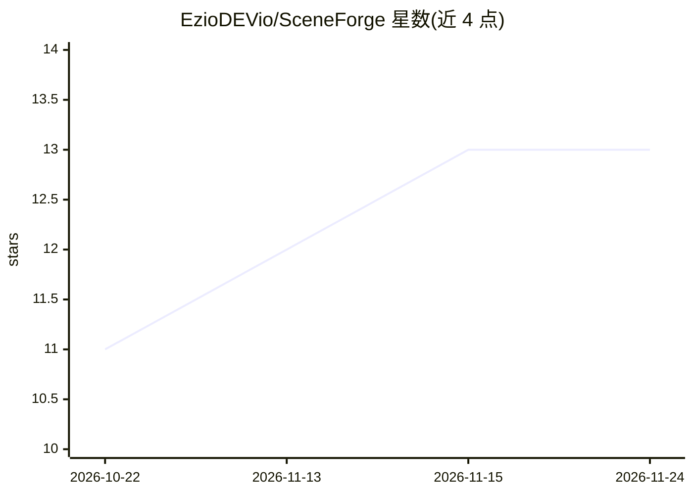

# EzioDEVio/SceneForge

⭐ 13 · Python · GPL-3.0 · 推送 2026-11-12 · [GitHub](https://github.com/EzioDEVio/SceneForge) · 个人维护

**面向叙事视频创作者的免费开源桌面编辑器**

基于 Electron 与 FastAPI 的桌面视频编辑器，将脚本、照片/视频素材与旁白合成为带字幕的成片，由本机 FFmpeg 渲染。提供多轨时间线、转场与特效、71 种字幕样式及阿拉伯语 RTL 支持。AI 功能为可选：本地一键安装 Whisper 字幕、Kokoro/Chatterbox 语音、Stable Diffusion 图像生成；也可用自有 API key 接入云端服务。提供 Windows/macOS/Linux 安装包，可从源码运行。

## 筛选速览

| 维度 | 判定 | 备注 |
|---|---|---|
| AI 角色 | `ai-enhanced` | 去掉 AI 部分产品仍成立 |
| 许可风险 | `viral` | GPL-3.0 |
| 部署形态 | `desktop` | 安装包/桌面程序 |
| 模型依赖 | — | README 未给出锁定关系 |
| 硬件要求 | — | 无带数字的原话,不猜 |
| 安装摩擦 | `medium` | 含编译或系统依赖之一 |
| 成熟度 | — | 结构信号不足 |

## 能力要点

- 本地一键安装 Whisper 字幕、Kokoro/Chatterbox 语音与 Stable Diffusion 图像生成
- 多轨时间线专业剪辑工具（ripple/roll/slip/slide/blade）与节拍同步
- 71 种字幕样式，支持阿拉伯语从右到左排版
- 本机 FFmpeg 渲染，无账户、无水印、无订阅

## 适用场景

- 把照片和旁白脚本做成带字幕的纪录短片
- 在本地机器上生成 AI 配音与图像，不上传素材
- 制作适配 YouTube/Shorts/TikTok 等平台的多比例视频

## 场景标签

`图像生成` `语音识别` `图像视频处理` · 领域:内容生成

## 证据(README 行号)

> L15: **SceneForge Studio turns a script, your photos and clips, and a voice into a finished, captioned video, one scene 
> L74: You can make a complete video from your own photos, clips and recordings without any account. When you want AI, cho

## 星数曲线

2026-10-22 11 → 2026-11-24 13（+2）

---
*卡片 v1 · prompt 1.4 · 生成 2026-11-18 · 置信度 high · 依据 README sha `fed21952fcd6` · [字段定义](../../DATASET.md)*
