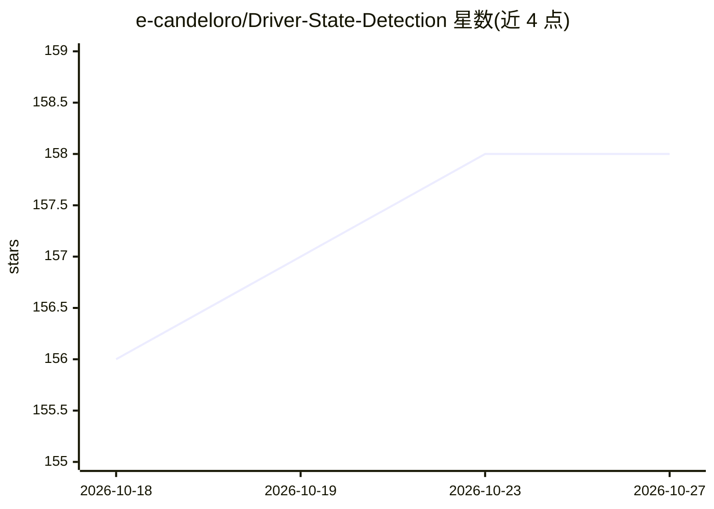

# e-candeloro/Driver-State-Detection

⭐ 158 · Python · MIT · 推送 2026-08-18 · [GitHub](https://github.com/e-candeloro/Driver-State-Detection) · 组织维护

**基于摄像头的驾驶员注意力状态实时监测系统**

使用 Python、OpenCV 与 MediaPipe Face Landmarker 的实时驾驶员状态监测应用：从摄像头画面检测人脸并预测 478 个面部与虹膜关键点，计算 EAR（眼睛纵横比）、视线分数、头部姿态三个欧拉角与 PERCLOS 四项指标，将状态分类为正常、疲劳、入睡、视线偏离与分心，并给出屏幕警告。检测离线运行，需先下载 Face Landmarker 模型。项目为摩德纳大学 2020/2021 学年计算机视觉课程的期末小组作品，MIT 许可证发布。

## 筛选速览

| 维度 | 判定 | 备注 |
|---|---|---|
| AI 角色 | `ai-native` | 本体是模型或模型工具 |
| 许可风险 | `permissive` | MIT |
| 部署形态 | `None` |  |
| 模型依赖 | — | README 未给出锁定关系 |
| 硬件要求 | — | 无带数字的原话,不猜 |
| 安装摩擦 | `low` | 无编译、无系统依赖或容器化 |
| 成熟度 | — | 结构信号不足 |

## 能力要点

- MediaPipe 预测 478 个面部与虹膜关键点，离线运行
- 计算 EAR、视线分数、头部姿态欧拉角与 PERCLOS 四项指标
- 五种驾驶员状态分类并在屏幕输出警告
- 提供可配置参数的仪表盘界面（uv 管理的 Python 3.12 环境）

## 适用场景

- 监测驾驶员疲劳、闭眼、视线偏离与分心状态
- 作为车载驾驶员注意力监测的概念验证
- 学习面部关键点与头部姿态估计的实现方法

## 场景标签

`目标检测` · 领域:感知与多模态

## 证据(README 行号)

> L4: Real-time, webcam-based driver attention monitoring using Python, OpenCV, and MediaPipe.
> L15: The application detects the driver's face and uses MediaPipe to predict 478 face and iris landmarks.
> L137: This project was developed as part for a final group project for the course of Computer Vision and Cognitive Syste

## 星数曲线

2026-10-18 156 → 2026-10-27 158（+2）

---
*卡片 v1 · prompt 1.4 · 生成 2026-10-22 · 置信度 high · 依据 README sha `c1aa8dc62c09` · [字段定义](../../DATASET.md)*
