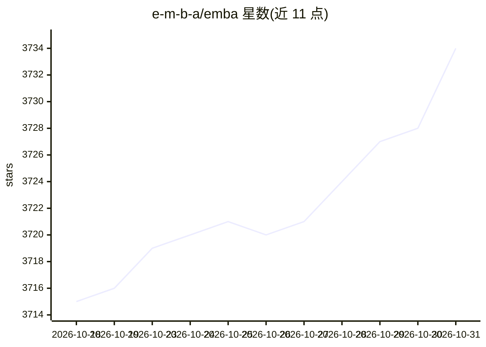

# e-m-b-a/emba

⭐ 3,734 · Shell · GPL-3.0 · 推送 2026-10-29 · [GitHub](https://github.com/e-m-b-a/emba) · [官网](https://www.securefirmware.de) · 组织维护

**嵌入式设备固件安全分析与 SBOM 工具，面向渗透测试者**

面向渗透测试人员、产品安全团队与开发者的命令行固件安全分析工具：从固件提取开始，进行静态分析与基于仿真的动态分析，生成 SBOM，并输出 Web 漏洞报告。自动发现不安全二进制、过期组件、潜在漏洞脚本与硬编码密码等薄弱点；工具提供信息由测试者自行判定重点并负责结果验证。通过 installer.sh 安装依赖，以扫描 profile 驱动（默认扫描/SBOM/系统仿真三种）。

## 筛选速览

| 维度 | 判定 | 备注 |
|---|---|---|
| AI 角色 | `ai-ecosystem` | LLM/agent 周边工具 |
| 许可风险 | `viral` | GPL-3.0 |
| 部署形态 | `None` |  |
| 模型依赖 | — | README 未给出锁定关系 |
| 硬件要求 | — | 无带数字的原话,不猜 |
| 安装摩擦 | `low` | 无编译、无系统依赖或容器化 |
| 成熟度 | — | 结构信号不足 |

## 能力要点

- 覆盖固件提取、静态分析、动态仿真、SBOM 生成与 Web 报告全流程
- 自动发现不安全二进制、过期组件、硬编码密码等薄弱点
- 提供 default-scan / default-sbom / default-scan-emulation 三种扫描 profile
- 为 OWASP 固件安全测试方法论组成部分

## 适用场景

- 对嵌入式设备固件做完整渗透测试分析
- 生成固件的 SBOM 与 Web 漏洞报告
- 通过系统仿真对固件做动态分析

## 场景标签

`网络安全` · 领域:学习与行业

## 证据(README 行号)

> L4: *EMBA* is designed as the central firmware analysis and SBOM tool for penetration testers, product security teams, d
> L6: *EMBA* assists the penetration testers, product security teams and developers in the identification of weak spots an

## 星数曲线

2026-10-18 3,715 → 2026-10-31 3,734（+19）

---
*卡片 v1 · prompt 1.4 · 生成 2026-10-20 · 置信度 mid · 依据 README sha `e9304bc9e679` · [字段定义](../../DATASET.md)*
