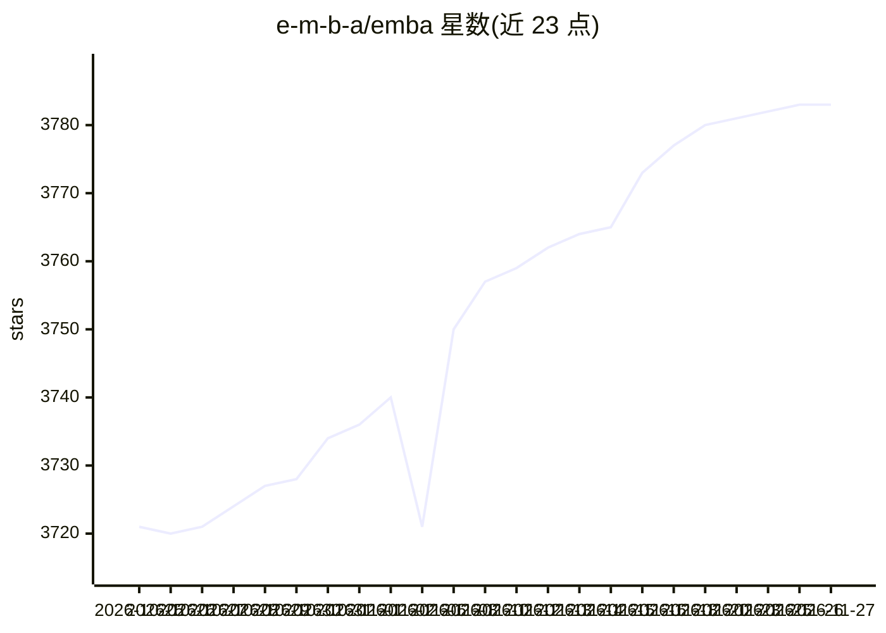

# e-m-b-a/emba

⭐ 3,783 · Shell · GPL-3.0 · 推送 2026-11-23 · [GitHub](https://github.com/e-m-b-a/emba) · [官网](https://www.securefirmware.de) · 组织维护

**给渗透测试与安全团队的嵌入式固件分析与SBOM工具**

面向渗透测试人员、产品安全团队、开发者和产品负责人的固件安全分析命令行工具，覆盖固件提取、静态分析、基于仿真的动态分析、SBOM 构建到生成 Web 漏洞报告的完整流程。可自动发现固件中的不安全二进制、过时软件组件、潜在漏洞脚本和硬编码密码等弱点，结果由测试者负责验证与解释。通过安装脚本安装依赖，提供默认扫描、SBOM 和系统仿真三种扫描配置档。

## 筛选速览

| 维度 | 判定 | 备注 |
|---|---|---|
| AI 角色 | `ai-enhanced` | 去掉 AI 部分产品仍成立 |
| 许可风险 | `viral` | GPL-3.0 |
| 部署形态 | `None` |  |
| 模型依赖 | — | README 未给出锁定关系 |
| 硬件要求 | — | 无带数字的原话,不猜 |
| 安装摩擦 | `low` | 无编译、无系统依赖或容器化 |
| 成熟度 | — | 结构信号不足 |

## 能力要点

- 固件提取→静态/动态分析→SBOM→Web 报告的全流程
- 基于仿真的动态分析与系统仿真扫描配置档
- 自动发现不安全二进制、过时组件、硬编码密码
- 命令行工具加可视化 Web 报告输出

## 适用场景

- 对 IoT/嵌入式设备固件做渗透测试前的静态与动态分析
- 为固件生成 SBOM 并排查过时软件组件
- 扫描固件镜像中的硬编码密码与不安全脚本

## 场景标签

`网络安全` · 领域:学习与行业

## 证据(README 行号)

> L4: *EMBA* is designed as the central firmware analysis and SBOM tool for penetration testers, product security teams, d
> L41: Before running *EMBA* make sure, that you have installed all dependencies with the installation script and met the 

## 星数曲线

2026-10-25 3,721 → 2026-11-27 3,783（+62）

---
*卡片 v1 · prompt 1.4 · 生成 2026-11-23 · 置信度 mid · 依据 README sha `e31ea60d7d99` · [字段定义](../../DATASET.md)*
