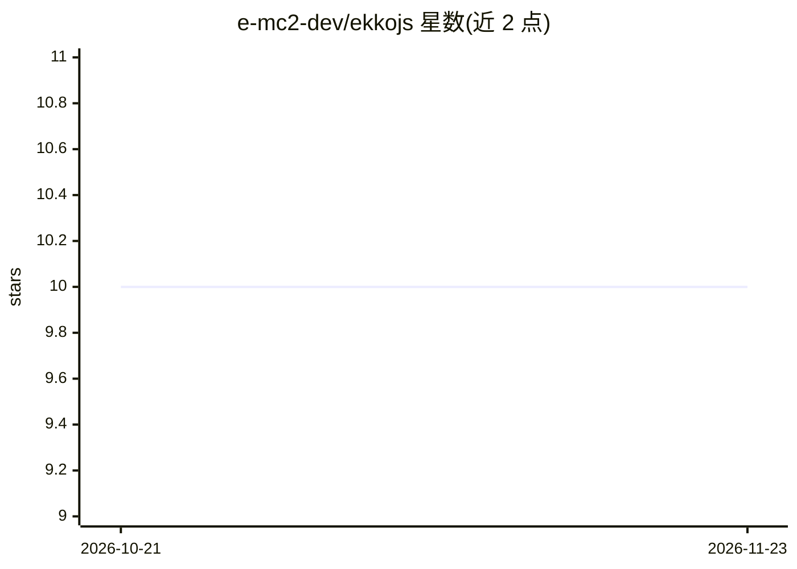

# e-mc2-dev/ekkojs

⭐ 10 · TypeScript · MIT · 推送 2026-06-27 · [GitHub](https://github.com/e-mc2-dev/ekkojs) · [官网](https://ekkojs.com) · 组织维护

**面向 AI 编码时代的 JavaScript/TypeScript 运行时**

EkkoJS 是一个 ESM 优先的 JavaScript/TypeScript 运行时，由 Rust 宿主、V8 与 .NET 10 AOT 层构成。核心机制是 `ekko doc --llm`：向 LLM 输出与已安装版本一致的运行时文档与示例，使其无需微调或预训练即可生成正确 API 调用。内置 HTTP 服务器、安全中间件、测试运行器、ORM、真实 OS 线程与类型化通道等后端能力，一次安装包含全部组件。安装脚本支持 macOS/Linux/Windows；项目处于早期公开预览阶段，API 可能变化。

## 筛选速览

| 维度 | 判定 | 备注 |
|---|---|---|
| AI 角色 | `ai-ecosystem` | LLM/agent 周边工具 |
| 许可风险 | `permissive` | MIT |
| 部署形态 | `None` |  |
| 模型依赖 | — | README 未给出锁定关系 |
| 硬件要求 | — | 无带数字的原话,不猜 |
| 安装摩擦 | `medium` | 含编译或系统依赖之一 |
| 成熟度 | `idea` | |

## 能力要点

- `ekko doc --llm` 提供运行时可读文档，供 LLM 按当前版本生成代码
- 直接运行 .ts/.tsx，无需构建步骤，纯 ESM 设计
- 通过 V8 isolate 池提供真实 OS 线程、结构化并发与类型化通道
- 内置 HTTP 服务器、CORS/Helmet/限流、测试运行器与跨五种数据库的 ORM

## 适用场景

- 让编码 agent/LLM 助手零训练地生成 EkkoJS 代码
- 用单运行时替代拼装路由、安全、测试、ORM 等多个依赖包的后端开发
- 需要多核并行与线程取消级联的 JS 后端任务

## 场景标签

 · 领域:开发工具/编程语言运行时

## 证据(README 行号)

> L15: EkkoJS is a JavaScript / TypeScript runtime built for the AI coding era.
> L25: > Any capable LLM should be able to code with EkkoJS without prior training, fine-tuning, or hallucinated APIs by f
> L117: This makes EkkoJS especially useful for AI-assisted development tools, coding agents, and developers working with 

## 星数曲线

2026-10-21 10 → 2026-11-23 10（+0）

---
*卡片 v1 · prompt 1.4 · 生成 2026-11-19 · 置信度 high · 依据 README sha `5922b2bb31da` · [字段定义](../../DATASET.md)*
