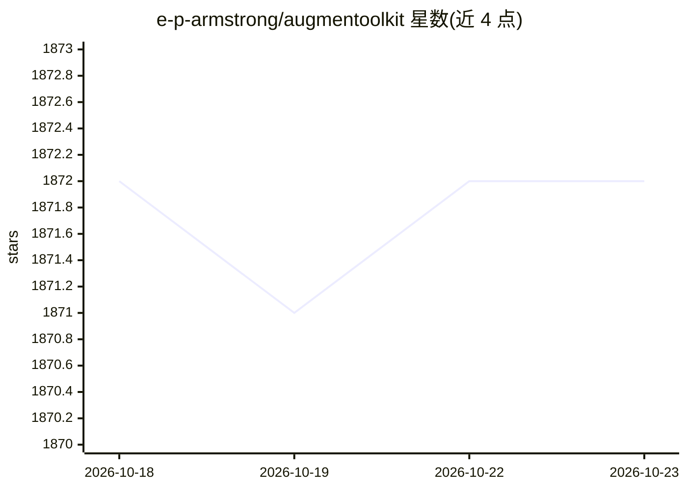

# e-p-armstrong/augmentoolkit

⭐ 1,872 · Python · MIT · 推送 2026-06-27 · [GitHub](https://github.com/e-p-armstrong/augmentoolkit) · 个人维护

**用自有文档生成训练数据并微调领域专家 LLM 的工具包**

面向想训练自定义 LLM 的爱好者与专业开发者：上传文档后，通过多条数据生成流水线（事实问答、纠错、RAG 数据、多源召回等）自动构建训练集，并可自动完成微调、下载与本地推理部署。数据生成可在消费级硬件上离线运行，也支持通过 Deepinfra 等 API 加速；训练需自有强机器或自动租用。提供 GUI 界面与 CLI 两种使用方式，Python 3.11 环境下以脚本安装启动，配置文件带注释占位符，MIT 许可。

## 筛选速览

| 维度 | 判定 | 备注 |
|---|---|---|
| AI 角色 | `ai-ecosystem` | LLM/agent 周边工具 |
| 许可风险 | `permissive` | MIT |
| 部署形态 | `None` |  |
| 模型依赖 | local-ok | 支持本地模型 |
| 硬件要求 | — | 无带数字的原话,不猜 |
| 安装摩擦 | `low` | 无编译、无系统依赖或容器化 |
| 成熟度 | — | 结构信号不足 |

## 能力要点

- 文档→数据集→自动微调→本地推理的一键式流水线
- 可在消费级硬件上离线生成数据，无需外部 API key
- 20+ 条可组合的数据生成流水线（事实问答/纠错/RAG/GRPO 实验性等）
- 支持 GUI 界面与 CLI，运行中断后自动续跑

## 适用场景

- 用自己领域的文档训练一个领域专家 LLM
- 为现有模型生成事实问答与 RAG 就绪数据集
- 在本地硬件上低成本生成训练数据并自动微调

## 场景标签

`微调` · 领域:训练与推理

## 证据(README 行号)

> L2: Augmentoolkit creates domain-expert datasets that update an AI's brain (basically, its knowledge cutoff), so that th
> L6: Maybe you want AI to know the latest research papers in your field, or perhaps you want an LLM that understands your
> L158: - **Fast:** when using APIs, you can quickly generate millions of trainable tokens. Fully async code lets you get 

## 星数曲线

2026-10-18 1,872 → 2026-10-23 1,872（+0）

---
*卡片 v1 · prompt 1.4 · 生成 2026-10-21 · 置信度 high · 依据 README sha `cdddd01970c2` · [字段定义](../../DATASET.md)*
