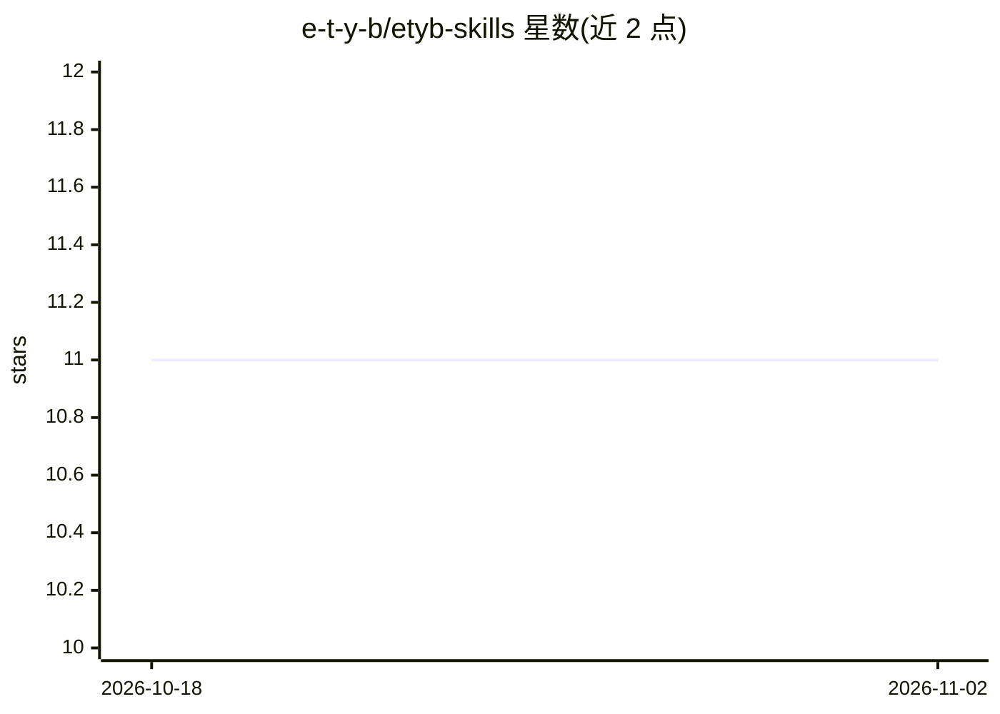

# e-t-y-b/etyb-skills

⭐ 11 · Shell · MIT · 推送 2026-07-06 · [GitHub](https://github.com/e-t-y-b/etyb-skills) · [官网](https://etyb.ai/skills) · 组织维护

**为编码 agent 安装虚拟工程团队的单技能 /etyb**

面向 Claude Code、OpenAI Codex、Cursor、Kiro、Trae、Antigravity 等编码 agent 的单一技能包：通过 npx skills add 或 Claude Code 插件安装，用户仅调用 /etyb 一个命令，内部按需路由到 14 个专家角色、9 个常驻协议（TDD、评审、验证等）、6 个垂直领域与 13 个带知识时效戳的厂商 Stack Pack（AWS/GCP/Azure/Anthropic/OpenAI 等），并以分层渐进加载控制 token 成本；Claude Code 插件路径附带告警式 hooks。多数协议当前为 model-trusted（仅靠指令约束），确定性 hooks 与 agent 定义在 v5 M2 计划交付。

## 筛选速览

| 维度 | 判定 | 备注 |
|---|---|---|
| AI 角色 | `ai-ecosystem` | LLM/agent 周边工具 |
| 许可风险 | `permissive` | MIT |
| 部署形态 | `library` | 以包/库形式分发 |
| 模型依赖 | — | README 未给出锁定关系 |
| 硬件要求 | — | 无带数字的原话,不猜 |
| 安装摩擦 | `low` | 无编译、无系统依赖或容器化 |
| 成熟度 | — | 结构信号不足 |

## 能力要点

- 单一 /etyb 触发，内部路由 14 专家 + 9 协议 + 6 垂直领域
- 13 个 Stack Pack 带知识时效戳、来源 URL 与漂移风险评级
- 分层渐进披露加载（SKILL.md 约 800 tokens，参考按需加载）
- 支持 skills CLI 与 Claude Code 原生插件两种安装方式

## 适用场景

- 让我的编码 agent 按 TDD 与评审纪律交付代码
- 在 fintech/医疗等高合规代码库中获得可追溯的工程决策
- 让 agent 掌握特定云厂商/平台的最新实践知识

## 场景标签

`编码 Agent` `代码审查` · 领域:编码与开发

## 证据(README 行号)

> L20: **Install a virtual engineering company.** One slash command — `/etyb` — gives your AI agent a CTO, 20 specialists,
> L44: |**Claude Code**|Model-trusted today; deterministic hooks + agents ship in v5 M2|Full `/etyb` skill via skills CLI 
> L157: The `skills` CLI installs the full `/etyb` skill — 14 specialists + 9 protocols + 6 verticals — into every detecte

## 星数曲线

2026-10-18 11 → 2026-11-02 11（+0）

---
*卡片 v1 · prompt 1.4 · 生成 2026-11-02 · 置信度 high · 依据 README sha `05fbd9f330fe` · [字段定义](../../DATASET.md)*
