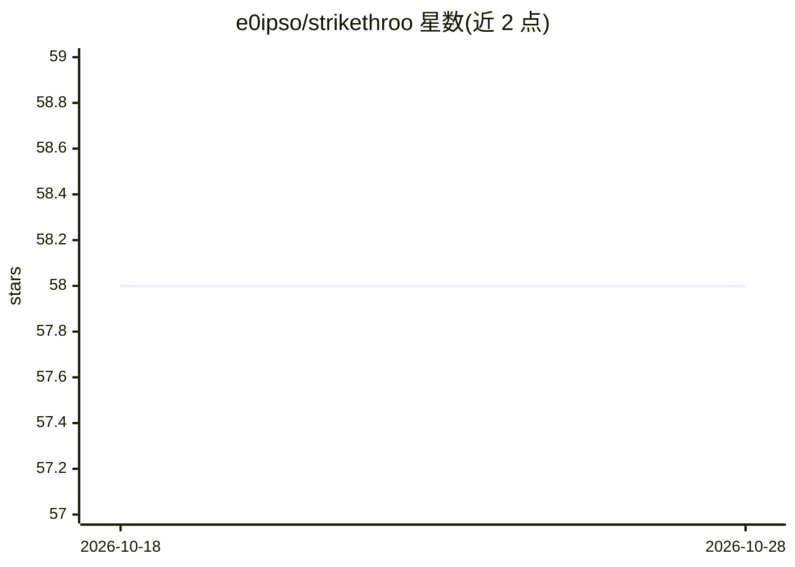

# e0ipso/strikethroo

⭐ 58 · TypeScript · MIT · 推送 2026-10-28 · [GitHub](https://github.com/e0ipso/strikethroo) · [官网](https://strikethroo.canpicasoft.com) · 个人维护

**AI 编程助手的规格驱动任务管理框架：计划审批+原子任务+复核门**

面向 AI 编程助手（claude code、codex、gemini-cli、opencode 等 Agent Skills 兼容 harness）的规格驱动工作流：把编程请求分解为计划与原子任务，人在计划阶段审批而非审查 diff；执行后可选运行基于第二 harness 的自动代码复核门，输出经 schema 校验的报告。通过 11 个 Markdown hook 点、模板与项目上下文文件做定制，无需插件代码；另提供可视化 Web 界面与 CI 可用的 validate 命令。需 Node.js 22+，npx 安装。

## 筛选速览

| 维度 | 判定 | 备注 |
|---|---|---|
| AI 角色 | `ai-ecosystem` | LLM/agent 周边工具 |
| 许可风险 | `permissive` | MIT |
| 部署形态 | `library` | 以包/库形式分发 |
| 模型依赖 | — | README 未给出锁定关系 |
| 硬件要求 | — | 无带数字的原话,不猜 |
| 安装摩擦 | `low` | 无编译、无系统依赖或容器化 |
| 成熟度 | — | 结构信号不足 |

## 能力要点

- 计划审批门：人审计划而非 diff，每步干净上下文
- 可选代码复核门运行于结构上排除的第二个 harness，只报告不修复
- 11 个 Markdown hook 点与模板注入测试命令、规范、领域规则
- npx strikethroo serve 本地可视化计划/任务/依赖图；validate 可作 CI 步骤

## 适用场景

- 让 AI 编程助手按原子任务分阶段执行并逐阶段提交
- 在写代码前用一句话纠正计划，减少返工评审轮次
- 用自动复核门获得 schema 校验的发现报告
- 在 CI 中校验工作区一致性

## 场景标签

`工作流自动化` `Agent 框架` · 领域:Agent 开发

## 证据(README 行号)

> L83: Requires Node.js 22+ and an assistant that supports the Agent Skills format.
> L67: npx strikethroo init --harnesses claude

## 星数曲线

2026-10-18 58 → 2026-10-28 58（+0）

---
*卡片 v1 · prompt 1.4 · 生成 2026-10-24 · 置信度 high · 依据 README sha `9e487ce712ca` · [字段定义](../../DATASET.md)*
