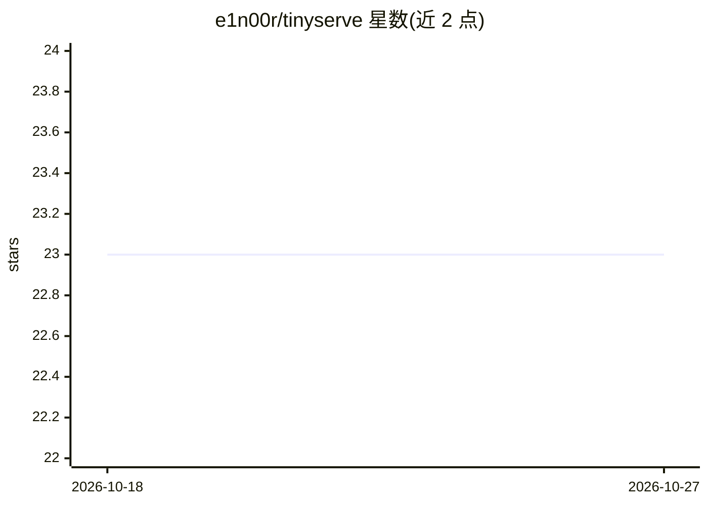

# e1n00r/tinyserve

⭐ 23 · Python · MIT · 推送 2026-04-07 · [GitHub](https://github.com/e1n00r/tinyserve) · 个人维护

**消费级单卡上运行放不进显存的 MoE 模型的推理框架**

面向单张 NVIDIA GPU 的 MoE 专家卸载推理框架：将放不进显存的专家权重以 GGUF 原生量化格式零拷贝 mmap 在 CPU 内存，推理时通过 ggml CUDA MMVQ 内核在 GPU 上以量化格式直接计算，无反量化步骤；配合 GPU LFRU 专家缓存、FATE 预取、StreamingLLM 与 FP8 KV cache 实现长上下文下的吞吐维持。提供 Python API、CLI（含 OpenAI 兼容 API 服务）与 REPL。限制：仅支持 NVIDIA CUDA、单 GPU、batch size 1 解码。

## 筛选速览

| 维度 | 判定 | 备注 |
|---|---|---|
| AI 角色 | `ai-ecosystem` | LLM/agent 周边工具 |
| 许可风险 | `permissive` | MIT |
| 部署形态 | `library` | 以包/库形式分发 |
| 模型依赖 | local-ok | 支持本地模型 |
| 硬件要求 | — | 无带数字的原话,不猜 |
| 安装摩擦 | `medium` | 含编译或系统依赖之一 |
| 成熟度 | — | 结构信号不足 |

## 能力要点

- GGUF/MXFP4 原生量化计算，零反量化，零拷贝 mmap 专家存储
- GPU LFRU 专家缓存 + FATE 层间专家预取
- StreamingLLM 与 FP8 KV cache 支持长上下文（8GB 上 53K token）
- CLI 提供 OpenAI 兼容 API 与交互式 REPL

## 适用场景

- 在 8GB 显存的笔记本 GPU 上运行 GPT-OSS-20B 等 MoE 模型
- 显存不足时通过专家卸载运行更大的 MoE 模型
- 以 OpenAI 兼容 API 形式在本地提供 MoE 模型服务

## 场景标签

`推理引擎` · 领域:训练与推理

## 证据(README 行号)

> L3: Run Mixture-of-Experts models that don't fit in VRAM on a single NVIDIA GPU. **30 tok/s** decode for a 20B MoE model
> L56: tinyserve serve --model openai/gpt-oss-20b --port 8000   # OpenAI-compatible API
> L61: ## How it works

## 星数曲线

2026-10-18 23 → 2026-10-27 23（+0）

---
*卡片 v1 · prompt 1.4 · 生成 2026-10-27 · 置信度 high · 依据 README sha `dcef941edb7c` · [字段定义](../../DATASET.md)*
