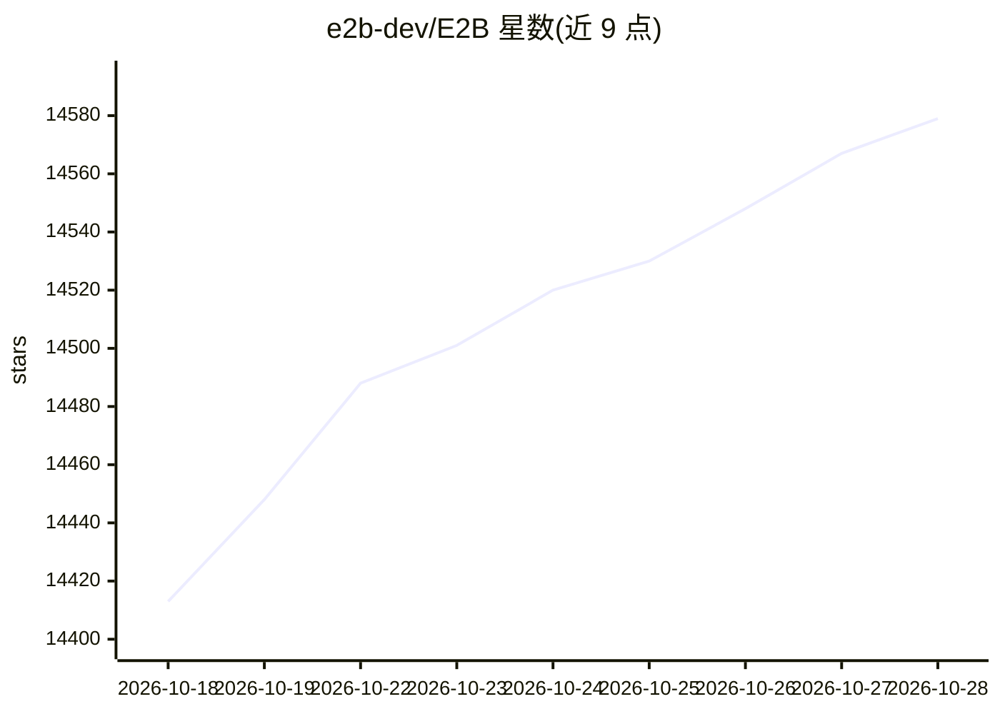

# e2b-dev/E2B

⭐ 14,579 · Python · Apache-2.0 · 推送 2026-10-27 · [GitHub](https://github.com/e2b-dev/E2B) · [官网](https://docs.e2b.dev/?utm_source=github&utm_medium=referral&utm_campaign=repo_website&utm_content=e2b) · 组织维护

**为 AI agent 提供云端安全沙箱，运行生成的代码**

E2B 是开源基础设施，在云端安全隔离沙箱中运行 AI 生成的代码，通过 JavaScript 或 Python SDK 创建并控制沙箱。提供三个 SDK：核心沙箱 SDK（执行命令）、Code Interpreter SDK（runCode 执行代码并获取结果）、Desktop SDK（鼠标、键盘、截图、桌面流等计算机操作 API）。使用需注册获取 API key 并设置环境变量；支持通过 Terraform 自托管部署到自有云环境。

## 筛选速览

| 维度 | 判定 | 备注 |
|---|---|---|
| AI 角色 | `ai-ecosystem` | LLM/agent 周边工具 |
| 许可风险 | `permissive` | Apache-2.0 |
| 部署形态 | `library` | 以包/库形式分发 |
| 模型依赖 | — | README 未给出锁定关系 |
| 硬件要求 | — | 无带数字的原话,不猜 |
| 安装摩擦 | `low` | 无编译、无系统依赖或容器化 |
| 成熟度 | — | 结构信号不足 |

## 动量与使用信号

- 维护:`active` — 距上次 push 3.4 天,年发版 100,60 位贡献者
- 涨星:近 1 天 **+29**(自 20261016 起算)
- 安装:npm 包 `e2b` 月下载 8,278,226
- 平台:LINUX · 协议:—

## 能力要点

- 云端隔离沙箱中运行 AI 生成的代码
- JavaScript 与 Python 双 SDK，另有 Code Interpreter 与 Desktop 扩展 SDK
- Desktop SDK 提供鼠标、键盘、截图与应用流 API
- 支持 Terraform 自托管，支持 AWS/GCP/Azure/Linux

## 适用场景

- 为 agent 提供安全的代码执行环境
- 让 LLM 生成的 Python/JS 代码在沙箱中运行并取回结果
- agent 的计算机使用场景：操控浏览器、截屏等
- 在自有云基础设施上部署沙箱运行时

## 场景标签

`Agent 框架` `GUI 自动化` · 领域:Agent 开发

## 证据(README 行号)

> L13: E2B is an open-source infrastructure that allows you to run AI-generated code in secure isolated sandboxes in the c
> L99: Read the embed deployment guide to learn how to set up the E2B runtime on your own. The infrastructure is deployed 

## 星数曲线

2026-10-18 14,413 → 2026-10-28 14,579（+166）

---
*卡片 v1 · prompt 1.4 · 生成 2026-10-18 · 置信度 high · 依据 README sha `3f76b95304af` · [字段定义](../../DATASET.md)*
