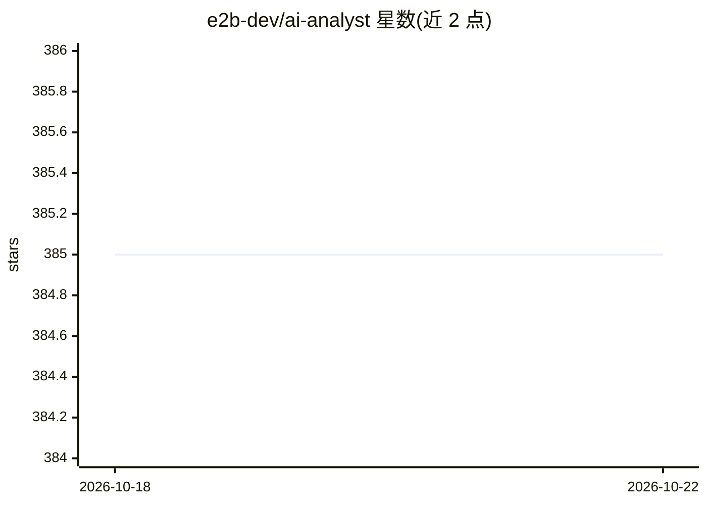

# e2b-dev/ai-analyst

⭐ 385 · TypeScript · Apache-2.0 · 推送 2026-10-20 · [GitHub](https://github.com/e2b-dev/ai-analyst) · [官网](https://ai-analyst.e2b.dev) · 组织维护

**基于 E2B 沙箱的 AI 数据分析工具：用 Llama 3.1 分析 CSV 并生成交互图表**

E2B 开源的 AI 数据分析 Web 应用：用户上传 CSV 文件，由 Meta Llama 3.1 模型在 E2B 沙箱中执行代码分析，并用 echarts 生成交互式图表。基于 Next.js 与 Vercel AI SDK 构建，支持 TogetherAI、Fireworks、Anthropic、OpenAI 及 Ollama（仅 allowlist 的 llama3.1，需 HTTPS 端点）作为 LLM 提供方。云端提供方支持 BYOK，密钥校验与服务端密钥不回退。通过 git clone 与 npm 安装本地运行，需配置 E2B API key。

## 筛选速览

| 维度 | 判定 | 备注 |
|---|---|---|
| AI 角色 | `ai-native` | 本体是模型或模型工具 |
| 许可风险 | `permissive` | Apache-2.0 |
| 部署形态 | `library` | 以包/库形式分发 |
| 模型依赖 | local-ok | 支持本地模型 |
| 硬件要求 | — | 无带数字的原话,不猜 |
| 安装摩擦 | `low` | 无编译、无系统依赖或容器化 |
| 成熟度 | — | 结构信号不足 |

## 能力要点

- 上传 CSV 并由 Llama 3.1 在 E2B 沙箱中分析
- echarts 生成交互式图表
- 多 LLM 提供方支持（TogetherAI/Fireworks/Anthropic/OpenAI/Ollama）
- BYOK 密钥机制：无效密钥不回退服务端密钥

## 适用场景

- 上传 CSV 数据让 AI 做分析并生成图表
- 通过 Ollama 本地端点自托管 LLM 后端运行分析
- 在在线版本试用数据分析功能

## 场景标签

`数据分析` · 领域:效率与自动化

## 证据(README 行号)

> L2: This is an AI-powered code and data analysis tool built with Next.js and the E2B SDK.
> L9: - 🔸 Analyze data with Meta's Llama 3.1

## 星数曲线

2026-10-18 385 → 2026-10-22 385（+0）

---
*卡片 v1 · prompt 1.4 · 生成 2026-10-21 · 置信度 high · 依据 README sha `aa59e169b6a0` · [字段定义](../../DATASET.md)*
