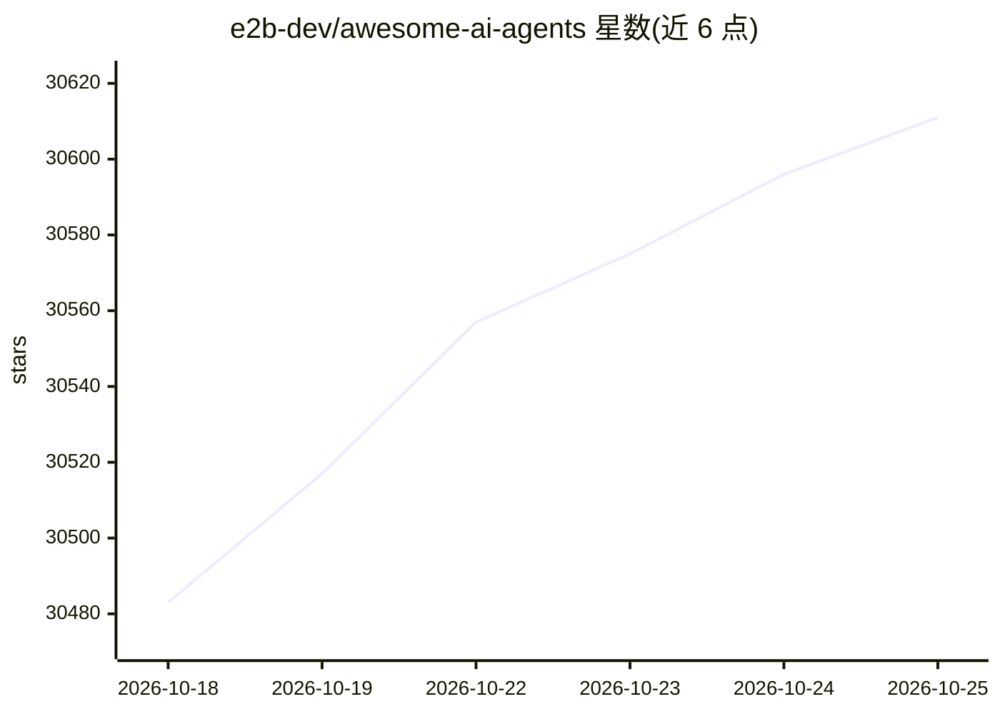

# e2b-dev/awesome-ai-agents

⭐ 30,611 · NOASSERTION · 推送 2026-08-21 · [GitHub](https://github.com/e2b-dev/awesome-ai-agents) · [官网](https://docs.e2b.dev/?utm_source=github&utm_medium=referral&utm_campaign=repo_website&utm_content=awesome-ai-agents) · 组织维护

**为开发者和研究者收录开源与闭源 AI 智能体项目的清单**

由 E2B 维护的 AI 自主智能体目录，将条目分为开源项目与闭源项目/公司两部分，每条记录名称、一句话简介、类别（如通用、多智能体、编码、HR 等）与相关链接（文档、论文、GitHub、Discord 等）。收录 Adala、AutoGen、AutoGPT、BabyAGI、Aider 等项目，并按字母序组织。清单自我声明不保证全面，提供 Web 版按类别与用例过滤，社区可通过 PR 或表单提交新条目。

## 筛选速览

| 维度 | 判定 | 备注 |
|---|---|---|
| AI 角色 | `ai-knowledge` | 知识聚合/清单类 |
| 许可风险 | `none` | NOASSERTION |
| 部署形态 | `library` | 以包/库形式分发 |
| 模型依赖 | — | README 未给出锁定关系 |
| 硬件要求 | — | 无带数字的原话,不猜 |
| 安装摩擦 | `medium` | 含编译或系统依赖之一 |
| 成熟度 | — | 结构信号不足 |

## 动量与使用信号

- 维护:`active` — 距上次 push 57.5 天,年发版 0,56 位贡献者
- 涨星:近 1 天 **+25**(自 20261016 起算)
- 安装:pypi 包 `bondai` 月下载 349
- 平台:WEB · 协议:OPENAI-API

## 能力要点

- 条目分开源项目与闭源项目/公司两部分组织
- 每个条目含类别、描述与文档/论文/GitHub 等链接
- 提供 Web 版界面按类别与用例过滤
- 通过 PR 或表单接受社区提交并要求按字母序排列

## 适用场景

- 查找适合自己需求的自主智能体开源项目
- 调研多智能体框架和编码类智能体的生态现状
- 按类别（通用/编码/HR/生产力等）筛选智能体产品

## 场景标签

`精选清单` · 领域:学习与行业

## 证据(README 行号)

> L17: Welcome to our list of AI agents.
> L18: We structured the list into two parts:
> L19: - Open source projects
> L20: - Closed-source projects and companies

## 星数曲线

2026-10-18 30,483 → 2026-10-25 30,611（+128）

---
*卡片 v1 · prompt 1.4 · 生成 2026-10-18 · 置信度 mid · 依据 README sha `f1d53983b45a` · [字段定义](../../DATASET.md)*
