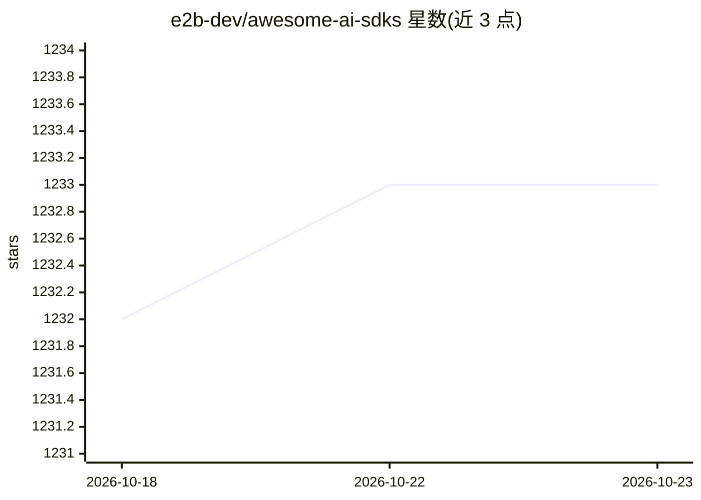

# e2b-dev/awesome-ai-sdks

⭐ 1,233 · 推送 2026-07-09 · [GitHub](https://github.com/e2b-dev/awesome-ai-sdks) · 组织维护

**面向 AI agent 开发的 SDK/框架/工具策展清单**

由 e2b 团队维护的 awesome 清单，收录用于创建、监控、调试和部署自主 AI agent 的 SDK、框架、库与工具数据库。条目按项目组织并附简介与链接，收录 E2B、AgentOps、Chidori、Fixie、Helicone、LangChain、Langfuse、LangSmith、Steamship、Vercel AI SDK 等约 12 个项目。清单自述按维护者最佳认知整理、并不全面，新增条目通过 pull request 提交。

## 筛选速览

| 维度 | 判定 | 备注 |
|---|---|---|
| AI 角色 | `ai-knowledge` | 知识聚合/清单类 |
| 许可风险 | `none` | — |
| 部署形态 | `None` |  |
| 模型依赖 | — | README 未给出锁定关系 |
| 硬件要求 | — | 无带数字的原话,不猜 |
| 安装摩擦 | `low` | 无编译、无系统依赖或容器化 |
| 成熟度 | — | 结构信号不足 |

## 动量与使用信号

- 安装:github 包 `release-assets` 月下载无数据

## 能力要点

- 收录 agent 创建/监控/调试/部署类 SDK 与框架的数据库式清单
- 条目附简介与官网/GitHub/Discord 等链接
- 由 e2b 团队维护，开放 PR 补充

## 适用场景

- 为构建 AI agent 挑选框架或 SDK 时查找候选
- 了解 agent 开发生态中的监控/可观测性工具
- 发现 agent 运行时与托管平台项目

## 场景标签

`精选清单` · 领域:学习与行业

## 证据(README 行号)

> L12: Welcome to our list of AI agents SDKs. A database of SDKs, frameworks, libraries, and tools for creating, monitorin
> L21: This list is made by the team behind e2b. E2b is building an operation system of AI agents - that is, a set of tool

## 星数曲线

2026-10-18 1,232 → 2026-10-23 1,233（+1）

---
*卡片 v1 · prompt 1.4 · 生成 2026-10-18 · 置信度 high · 依据 README sha `6952110bc790` · [字段定义](../../DATASET.md)*
