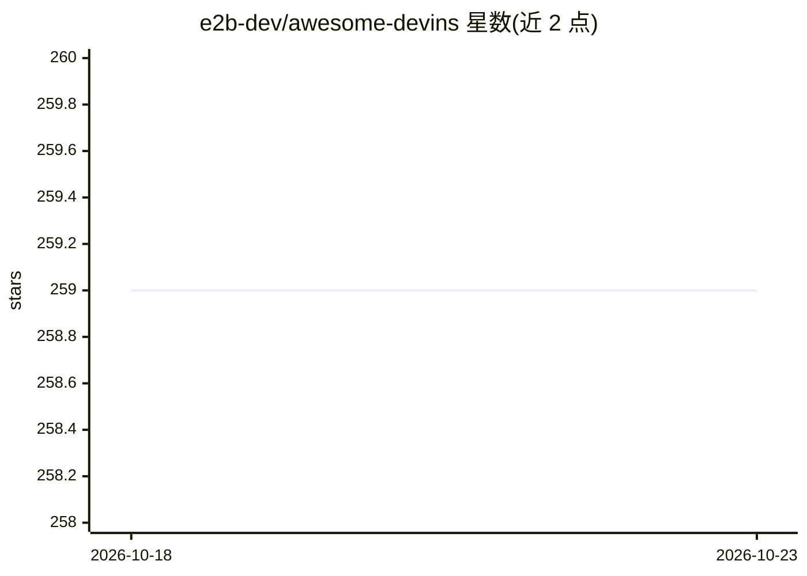

# e2b-dev/awesome-devins

⭐ 259 · 推送 2026-08-21 · [GitHub](https://github.com/e2b-dev/awesome-devins) · 组织维护

**受 Devin 启发的 AI 编程 Agent 策展清单**

由 E2B 维护的 awesome list，收录 Devin 发布后出现的开源与闭源 AI 软件 Agent（如 OpenDevin、Devika、SWE-agent、MetaGPT、Plandex 等），按开源/闭源分节，每个条目给出分类（Coding、通用、多智能体等）、功能描述与 GitHub/Discord/论文链接。面向想了解 AI 编程 Agent 生态的开发者，通过 PR 或表单提交新条目，并附 E2B 云运行时推广入口。条目覆盖不全由维护者自行声明。

## 筛选速览

| 维度 | 判定 | 备注 |
|---|---|---|
| AI 角色 | `ai-knowledge` | 知识聚合/清单类 |
| 许可风险 | `none` | — |
| 部署形态 | `None` |  |
| 模型依赖 | — | README 未给出锁定关系 |
| 硬件要求 | — | 无带数字的原话,不猜 |
| 安装摩擦 | `low` | 无编译、无系统依赖或容器化 |
| 成熟度 | — | 结构信号不足 |

## 能力要点

- 收录开源与闭源两类 Devin 类 AI Agent
- 每条目含类别、描述与链接（GitHub/Demo/论文/Discord）
- 支持通过 PR 或表单提交新产品
- 附有 AI Agent 生态全景图与相关 SDK 清单入口

## 适用场景

- 查找和比较 Devin 类开源 AI 编程 Agent
- 跟踪 AI 软件工程 Agent 生态的新项目
- 为选型调研收集各 Agent 的能力与基准信息

## 场景标签

`精选清单` · 领域:学习与行业

## 证据(README 行号)

> L16: Welcome to our list of AI agents that are inspired by release of Devin. See the 🌟 complete list of AI agents on Git
> L28: # Open-source "Devins"
> L228: # Closed-source "Devins"

## 星数曲线

2026-10-18 259 → 2026-10-23 259（+0）

---
*卡片 v1 · prompt 1.4 · 生成 2026-10-22 · 置信度 high · 依据 README sha `483741c5debe` · [字段定义](../../DATASET.md)*
