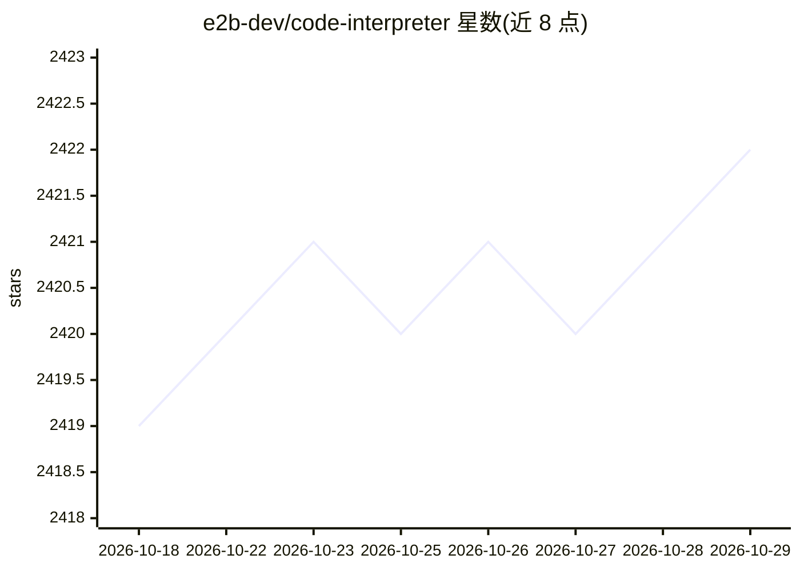

# e2b-dev/code-interpreter

⭐ 2,422 · Python · Apache-2.0 · 推送 2026-10-28 · [GitHub](https://github.com/e2b-dev/code-interpreter) · [官网](https://e2b.dev/?utm_source=github&utm_medium=referral&utm_campaign=repo_website&utm_content=code-interpreter) · 组织维护

**在云端安全沙箱中运行 AI 生成代码的 Python/JS SDK**

E2B 提供的开源基础设施 SDK：通过 JavaScript/TypeScript 与 Python 包在云端安全隔离沙箱中启动、控制并执行代码，沙箱内运行代码解释器可执行 AI 生成的代码并返回结果。使用需注册 E2B 账号并设置 E2B_API_KEY。注意：SDK 源码已迁入 E2B monorepo，本仓库保留沙箱模板与图表数据提取器，且产品标注为 Preview 状态。支持构建自定义沙箱模板。

## 筛选速览

| 维度 | 判定 | 备注 |
|---|---|---|
| AI 角色 | `ai-ecosystem` | LLM/agent 周边工具 |
| 许可风险 | `permissive` | Apache-2.0 |
| 部署形态 | `library` | 以包/库形式分发 |
| 模型依赖 | — | README 未给出锁定关系 |
| 硬件要求 | — | 无带数字的原话,不猜 |
| 安装摩擦 | `low` | 无编译、无系统依赖或容器化 |
| 成熟度 | `idea` | |

## 能力要点

- Python 与 JS/TS 双语言 SDK
- 云端隔离沙箱内执行 AI 生成代码并返回结果
- 可构建自定义沙箱模板（不同运行时/额外包）
- 提供 Cookbook 示例集合

## 适用场景

- 为 AI 应用添加安全的代码执行能力
- 构建数据分析类 agent 时隔离运行生成代码
- 按需扩展沙箱运行时环境

## 场景标签

`数据分析` · 领域:效率与自动化

## 证据(README 行号)

> L16: ## What is E2B?
> L17: E2B is an open-source infrastructure that allows you to run AI-generated code in secure isolated sandboxes in the c

## 星数曲线

2026-10-18 2,419 → 2026-10-29 2,422（+3）

---
*卡片 v1 · prompt 1.4 · 生成 2026-10-21 · 置信度 high · 依据 README sha `ff49628bcb90` · [字段定义](../../DATASET.md)*
