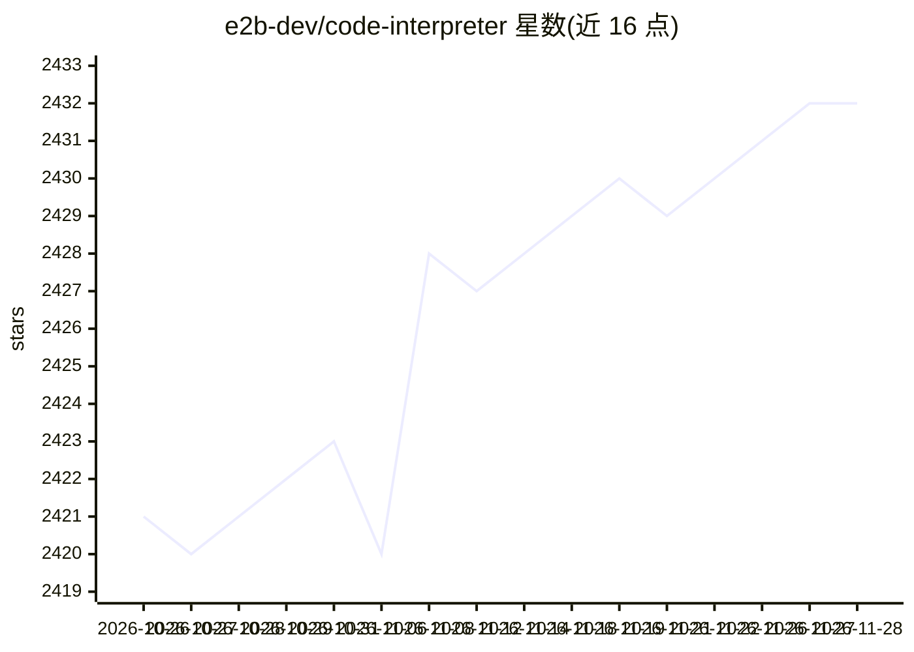

# e2b-dev/code-interpreter

⭐ 2,432 · Python · Apache-2.0 · 推送 2026-11-25 · [GitHub](https://github.com/e2b-dev/code-interpreter) · [官网](https://e2b.dev/?utm_source=github&utm_medium=referral&utm_campaign=repo_website&utm_content=code-interpreter) · 组织维护

**给 AI 应用执行生成代码的云端沙箱 SDK**

E2B 提供云端隔离沙箱基础设施，供 AI 应用运行 AI 生成的代码，通过 JavaScript/Python SDK 启动并控制沙箱，在沙箱内执行代码解释器并读取执行结果。使用前需注册获取 E2B API key 并设置环境变量；SDK 源码已迁入 E2B monorepo，本仓库保留沙箱模板（含图表数据提取器），支持自定义沙箱模板以添加依赖包或更换运行时。

## 筛选速览

| 维度 | 判定 | 备注 |
|---|---|---|
| AI 角色 | `ai-ecosystem` | LLM/agent 周边工具 |
| 许可风险 | `permissive` | Apache-2.0 |
| 部署形态 | `library` | 以包/库形式分发 |
| 模型依赖 | — | README 未给出锁定关系 |
| 硬件要求 | — | 无带数字的原话,不猜 |
| 安装摩擦 | `low` | 无编译、无系统依赖或容器化 |
| 成熟度 | `idea` | |

## 能力要点

- Python 与 JS/TS 双 SDK，云端隔离沙箱中运行 AI 生成代码
- 沙箱模板含图表数据提取器，可自定义模板与运行时
- Cookbook 提供不同 LLM 与 AI 框架的示例

## 适用场景

- 在 AI 应用中安全执行大模型生成的 Python/JS 代码
- 为 LLM 代理提供代码解释与数据分析执行环境
- 按需构建带额外依赖的代码执行沙箱模板

## 场景标签

 · 领域:LLM 基础设施/代码执行

## 证据(README 行号)

> L17: E2B is an open-source infrastructure that allows you to run AI-generated code in secure isolated sandboxes in the c
> L65: Visit our Cookbook to get inspired by examples with different LLMs and AI frameworks.

## 星数曲线

2026-10-26 2,421 → 2026-11-28 2,432（+11）

---
*卡片 v1 · prompt 1.4 · 生成 2026-11-23 · 置信度 high · 依据 README sha `5192b074afa4` · [字段定义](../../DATASET.md)*
